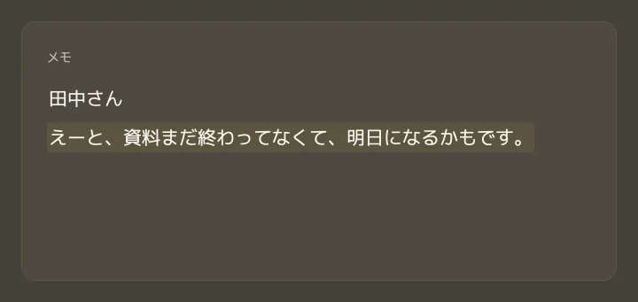
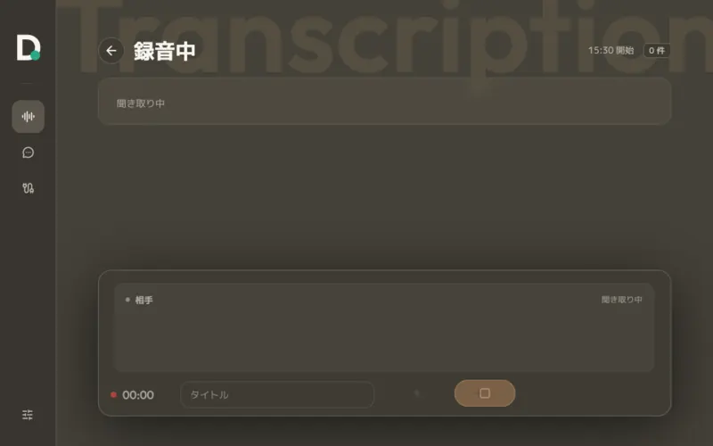
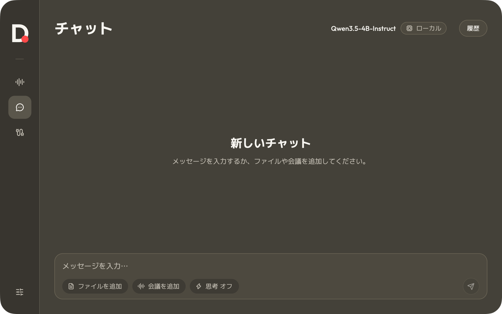

<p align="center">
  
</p>

<p align="center">
  <strong>ローカルファーストの macOS 向け音声アシスタント</strong>
</p>

<p align="center">
  Language: <a href="README.md">English</a> / <strong>日本語</strong> / <a href="README.zh-CN.md">简体中文</a> / <a href="README.ko.md">한국어</a>
</p>

音声入力、文章整形、書き換え、翻訳、要約、返信、質問、会議の書き起こしを扱える macOS アプリです。  
ローカルモデルを中心に動作し、履歴、音声、モデルはすべて Mac 上に保存されます。  
用途に応じてクラウドモデルを接続したり、プロンプトを編集したりすることもできます。

https://github.com/user-attachments/assets/c065b004-bfe3-4345-9d85-bf371178475a

> [!NOTE]
> Dito は現在、活発に開発を進めている初期段階にあるため、ビルド済みのパッケージは配布していません。ソースからのビルドとインストールは下のスクリプト 1 行で完了します。

## インストール

Apple シリコン搭載の Mac（macOS 13 以降、システム音声の録音は macOS 14.6 以降）に対応しています。

### ビルド環境

> [!TIP]
> 以下のツールが未導入でも、[Homebrew](https://brew.sh/) を入れたうえで下のインストールスクリプトを実行すれば、不足分を対話形式で導入できます。

1. [Rust](https://www.rust-lang.org/learn/get-started) 1.98 以降
2. CMake
3. [Apple コマンドラインツール](https://developer.apple.com/xcode/features/)（シェーダーのコンパイル時に Metal ツールチェーンが見つからないと出た場合は `bash scripts/setup-macos.sh` を実行してください）

### インストールスクリプトの実行

リポジトリのルートで以下を実行します。

```bash
bash scripts/install-local.sh
```

## 主な機能

### 1. 音声入力

ショートカットを押して話し、もう一度押すと、音声を認識して整えた文章がカーソル位置に入力されます。

音声認識モデル、テキストモデル、単語帳、プロンプトは自由に変更でき、アプリごとに整形ルールを分けることも可能です。  
手元のドキュメントから固有名詞や専門用語を抽出して単語帳に追加し、認識精度を上げる機能も備えています。

<p align="center"></p>

### 2. クイックコマンド

任意のアプリでテキストを選択し、ショートカットを押して指示を話すと、整形、書き換え、翻訳、要約、返信、質問を実行できます。

ローカルの小規模モデル向けに調整した分類器を内蔵しており、オフラインのまま指示の種類を判定します。  
声を出せないときは、HUD にカーソルを合わせてテキストで指示を入力できます。

<p align="center"></p>

### 3. 会議の書き起こし

ツールウィンドウから Mac のシステム音声、マイク、またはその両方を録音し、リアルタイムで書き起こします。停止後は前後の文脈を踏まえて段落ごとに整形し、会議のタイトルを自動生成します。各段落はその場で編集やコピーができます。

<p align="center"></p>

### 4. チャットとローカル API

選択中のテキストモデルを使ってチャットできます。ファイルや書き起こし済みの会議を添付して質問でき、回答は Markdown、コード、表でストリーミング表示されます。ローカルモデル選択時はやり取りがすべて Mac 内で完結します。また、「ローカル API」を有効にすると、OpenAI 互換 API と MCP 経由で同じ Mac 上の別アプリからローカルモデルを利用できます。

<p align="center"></p>

### そのほかの機能

| | |
| --- | --- |
| **アプリ別の整形** | 言語ごとの共通ルールをベースに、アプリ単位で整形ルールや文例を追加できます |
| **単語帳** | ホットワードのインポートとエクスポートに対応し、貼り付けたテキスト、ファイル、ほかの AI の回答から登録候補を抽出できます |
| **ローカルとクラウドの併用** | 音声認識とテキスト処理のそれぞれで、ローカルモデルとクラウド設定を個別に選択できます |
| **履歴と再実行** | 整形に失敗しても認識結果の原文をそのまま入力します。結果と音声は履歴に残り、あとから別モデルで再認識や再整形を行えます |
| **統計と多言語 UI** | 節約した時間、文字数、発話速度を記録します。UI は日本語、英語、中国語（簡体字、繁体字）、韓国語、モンゴル語、フランス語の 7 言語に対応しています |
| **ローカル保存** | 履歴、音声、モデルは Mac 内に保存されます。クラウドの API キーは macOS キーチェーンに格納され、設定ファイルには書き込まれません |

## モデル

> [!NOTE]
> ローカルモデルはすべてアプリ内からオンデマンドでダウンロードでき、レジュームとチェックサム検証に対応しています。

- 音声認識（ASR）
  - ローカルモデル
    - Qwen3-ASR 1.7B（デフォルト）
    - Qwen3-ASR 0.6B
    - SenseVoice Small
    - Haas-ja v1.0
    - Confucius4-R2T2
    - Fun-ASR-MLT-Nano-2512
    - Whisper large-v3
    - Whisper large-v3-turbo
    - Nemotron 3.5 Transcribe 30B-A4B
  - クラウド
    - FunASR
    - Qwen ASR
    - OpenRouter
    - カスタムリクエスト（内蔵 JSON エディタで定義）
- テキスト処理（整形、コマンド、チャット）
  - ローカルモデル
    - Qwen3.5 Instruct 2B
    - Qwen3.5 Instruct 4B
    - Qwen3.5 Instruct 9B（デフォルト）
    - Qwen3.8 27B
  - クラウド
    - Azure OpenAI
    - Amazon Bedrock
    - 任意の OpenAI 互換 API
- 発話検出（会議）
  - ローカルモデル
    - Silero VAD

## 開発

```bash
mise install                 # Rust、Python、uv、ruff を固定バージョンで導入
mise run dev:mock            # モックのクラウド、マイク、データでアプリを起動
mise run dev                 # 実マイク、モデル、プロバイダで起動
mise run check               # フォーマット確認と高速テスト
mise run lint:rust           # clippy（mock、screenshots 機能有効時を含む）
mise run readme:assets       # README のアニメーションを再生成（要 screenshots ビルド）
```

Dito は [GPUI](https://www.gpui.rs/) ベースの Rust ワークスペースです。UI はまず `design/dito.figcraft` で設計し、実装がそれに従います。

| 目的 | ドキュメント |
| --- | --- |
| ビルド、モック実行、テスト | [docs/IMPLEMENTATION.md](docs/IMPLEMENTATION.md) |
| ローカル実行、フラグ、原因調査 | [docs/DEBUGGING.md](docs/DEBUGGING.md) |
| アーキテクチャと設計判断 | [docs/ARCHITECTURE.md](docs/ARCHITECTURE.md)、[ADR](docs/adr/README.md) |
| 用語と実装箇所の対応 | [docs/GLOSSARY.md](docs/GLOSSARY.md) |
| 機能仕様と設計意図 | [design/features.md](design/features.md) |
| UI とモーションの規約 | [design/README.md](design/README.md) |
| AI エージェント向けガイド | [AGENTS.md](AGENTS.md) |

## ライセンス

[MIT](LICENSE)
