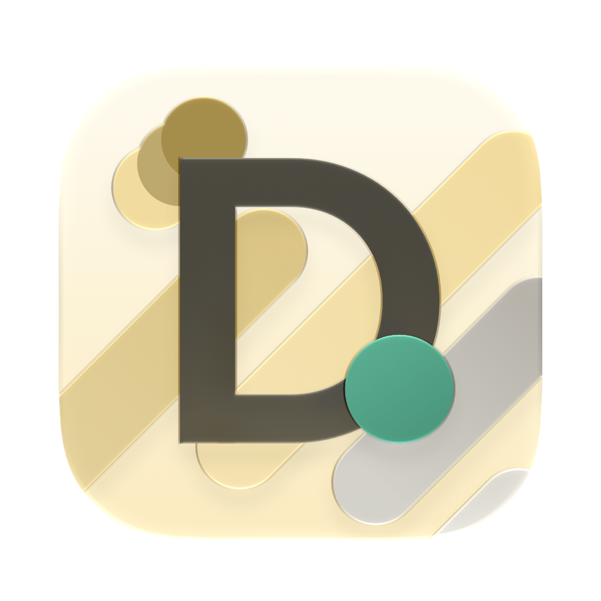

<p align="center">
  
</p>

<h1 align="center">Dito</h1>

<p align="center">
  <strong>macOS の音声入力アプリ。ショートカットを押して話すと、整えた文章がカーソルの位置に入力されます。</strong>
</p>

<p align="center">
  Language: <a href="README.md">English</a> / <strong>日本語</strong> / <a href="README.zh-CN.md">简体中文</a>
</p>

Dito は声を録音し、Mac 上またはクラウドのサービスで文字に起こします。必要に応じて言語モデルで文章を整え、いま操作しているアプリにそのまま入力します。音声認識とテキストモデルは、それぞれローカルかクラウドかを別々に選べます。クラウドのサービスを選ばない限り、データは Mac の外に出ません。画面は日本語が標準で、英語、简体中文、繁體中文、한국어、Монгол、Français にも切り替えられます。Dito は開発の初期段階にあり、変更が頻繁に入ります。

## インストール

**ダウンロード**: [最新のリリース](../../releases/latest)から zip を取得し、`Dito.app` を `Applications` に移して開きます。Apple シリコンの Mac と macOS 13 以降が必要です（システム音声の書き起こしは 14.6 以降）。

**ソースからビルド**: チェックアウトしたリポジトリで次を実行します。

```bash
bash scripts/install-local.sh
```

スクリプトは CMake と Rust を確認し（なければ確認のうえ Homebrew と rustup で導入します）、ローカルの `dito-dev` 署名 ID でビルドと署名を行い、`~/Applications/Dito.app` にインストールします。ビルドには Xcode コマンドラインツールと Xcode の Metal ツールチェーンが必要です（`bash scripts/setup-macos.sh` で導入できます）。更新を取り込んだら、同じコマンドをもう一度実行します。詳しくは [INSTALL.md](INSTALL.md) を参照してください。

**ほかのアプリに触れずに試す**: [mise](https://mise.jdx.dev/) を使い、モックのクラウドと合成マイクで動かします。

```bash
mise install
mise run dev:mock
```

**初回起動**: Dito はメニューバーに常駐し、初回の簡単なセットアップを除いて、自分からウィンドウを開きません。

1. 求められたら**マイク**と**アクセシビリティ**を許可します。アクセシビリティは、Dito がほかのアプリに文字を入力するために必要です。
2. **モデル**で、ローカルモデルをダウンロードするか、クラウドの設定を追加します。
3. 文字を入力できる場所にカーソルを置き、右 **⌘** キーを押して話し、もう一度押します。

<details>
<summary>アップデート後の権限</summary>

リリース版はアドホック署名のため、更新のたびに macOS が 2 つの権限をもう一度確認します。自分の署名 ID でソースからビルドすると、これを避けられます。詳しくは [docs/IMPLEMENTATION.md](docs/IMPLEMENTATION.md) を参照してください。

</details>

## できること

### 1. どのアプリでも、入力のかわりに話す

右 ⌘ を押して話し、もう一度押します。音声が文字になり、整えられて、カーソルの位置に入力されます。入力はキー入力かペーストを自動で切り替え、終わるとクリップボードを元に戻します。小さなカプセルが波形を表示しますが、フォーカスは奪いません。整形に失敗したときは書き起こしをそのまま入力し、入力先がなければクリップボードにコピーします。結果はすべて履歴に残ります。

<p align="center"></p>

### 2. 選択した文章に、声で指示する

どのアプリでも文章を選択し、⇧ と右 ⌘ を押して、やりたいことを話します。整形、書き換え、翻訳、要約、返信、質問に対応しています。書き換えは選択範囲を置き換え、返信や回答は小さなウィンドウで確認またはコピーします。コマンドにはローカルのテキストモデルが必要で、指示の内容もそのモデルが判断します。

<p align="center"></p>

### 3. 会議を書き起こす

ツールウィンドウは、Mac が再生する音（システム音声、macOS 14.6 以降）、マイク、またはその両方を録音し、話すそばから書き起こします。音声は発話検出モデルで区切られ、音声入力と同じ音声認識エンジンで認識されます。段落ごとに、その前の 2 つの段落を文脈として整形し、終わった会議には短いタイトルが付きます。段落はその場で編集でき、書き起こしはテキストとしてコピーできます。

<p align="center"></p>

### 4. Mac の上のモデルとチャットする

チャットは、文章整形で使っているテキストモデルをそのまま使うので、会話をデバイスの中にとどめられます。ファイルや終わった会議の書き起こしを添えて質問でき、回答は Markdown、コード、表を含めてストリーミングで表示されます。会話はすべて履歴に残ります。同じモデルは、ループバックアドレスで動くオプトインのローカル API（OpenAI 互換のエンドポイントと MCP）を通して、ほかのアプリにも貸し出せます。

<p align="center"></p>

## そのほか

| | |
| --- | --- |
| **アプリに合わせた整形** | 言語ごとの共通ルールの上に、Slack、Teams、追加したアプリごとの文体を設定できます |
| **単語帳** | 表記どおりに書かせたい単語を、ホットワードとして音声認識に、必要なら整形にも渡します。インポートとエクスポートのほか、貼り付けた文章やファイルから単語を探せます |
| **段階ごとにローカルかクラウドか** | オンデバイスの音声認識とテキストモデル、またはテンプレートから作るクラウドの設定 |
| **入力が失われない** | 整形に失敗しても書き起こしを入力します。無音やごく短い録音は静かに破棄します |
| **邪魔にならない** | 起動時にウィンドウを開かず、HUD はフォーカスを奪わず、視差効果を減らす設定にも従います |
| **履歴と統計** | 過去の結果を検索し、再生、再認識、再整形できます。節約した時間、文字数、話す速さも見られます |
| **標準でプライベート** | 履歴、音声、モデルは Mac の中にとどまり、クラウドの API キーはファイルではなく macOS のキーチェーンに保存されます |

## モデル

| 段階 | Mac の上 | クラウド |
| --- | --- | --- |
| 音声認識 | Qwen3-ASR 1.7B（標準）と 0.6B、SenseVoice Small、Whisper large-v3 などの追加ダウンロード | FunASR、Qwen ASR、OpenRouter、または JSON エディタで書く自分のリクエスト |
| テキスト（整形、コマンド、チャット） | Qwen3.5 Instruct 2B、4B、9B | Azure OpenAI、Amazon Bedrock、OpenAI 互換のサービス |
| 発話検出（会議） | Silero VAD | なし |

ダウンロードは頼んだときだけ始まり、再開でき、検証されます。

## 操作

| やりたいこと | 操作 |
| --- | --- |
| 音声入力する | 右 ⌘ を押して話し、もう一度押す |
| 録音中に取り消す | Esc、または HUD の × |
| 途中で確定する | HUD の ✓ |
| 認識や整形を止める | HUD の中止ボタン |
| キーを押している間だけ録音する | **一般**で「長押し」を選ぶ |
| 選択した文章を声で編集する | 文章を選択し、⇧ と右 ⌘ を押して、やりたいことを話す |
| ツールウィンドウを開く | Control、Option、T、またはメニューバーのアイコン |
| よく使う単語を覚えさせる | **単語帳** |
| アプリごとの整え方を変える | **プロンプト** |

録音は 5 分で止まりますが、その内容は処理されます。設定、履歴、録音した音声、ダウンロードしたモデルは `~/Library/Application Support/com.fang2hou.Dito` に保存されます。

## 開発

```bash
mise install                 # Rust、Python、uv、ruff を固定のバージョンで導入
mise run dev:mock            # モックのクラウド、マイク、データでアプリ全体を動かす
mise run dev                 # 実際のマイク、モデル、プロバイダで動かす
mise run check               # フォーマット確認と高速なテスト
mise run lint:rust           # clippy（mock と screenshots 機能の付いたビルドも含む）
mise run readme:assets       # README のアニメーションを作り直す
```

Dito は [GPUI](https://www.gpui.rs/) 上の Rust ワークスペースです。UI は `design/dito.figcraft` のデザインが先に決まり、コードがそれに従います。

| 目的 | 参照先 |
| --- | --- |
| ビルド、モック実行、テスト | [docs/IMPLEMENTATION.md](docs/IMPLEMENTATION.md) |
| ローカル実行、フラグ、不具合の調査 | [docs/DEBUGGING.md](docs/DEBUGGING.md) |
| アーキテクチャと設計判断 | [docs/ARCHITECTURE.md](docs/ARCHITECTURE.md)、[ADR](docs/adr/README.md) |
| 用語と各概念の置き場所 | [docs/GLOSSARY.md](docs/GLOSSARY.md) |
| アプリの機能と目的 | [design/features.md](design/features.md) |
| UI とモーションのデザイン | [design/README.md](design/README.md) |
| AI コーディングエージェントと作業する | [AGENTS.md](AGENTS.md) |

これらのドキュメントは英語です。

## コントリビュート

`develop` から `<type>/<kebab-name>` の形でブランチを切り、Conventional Commit 形式のタイトルで `develop` 宛てにプルリクエストを開きます。その前に `mise run check` と `mise run lint:rust` を実行してください。流れの全体は [docs/CONTRIBUTING.md](docs/CONTRIBUTING.md) にあります。

## ライセンス

[MIT](LICENSE)。同梱のフォントとアイコンは、それぞれのライセンスに従います。IBM Plex Sans SC（`crates/dito-app/assets/fonts/IBMPlexSansSC-LICENSE.txt`）と Lucide（`crates/dito-app/assets/icons/LUCIDE-LICENSE.txt`）です。ダウンロードするモデルには、それぞれのライセンスが適用されます。
