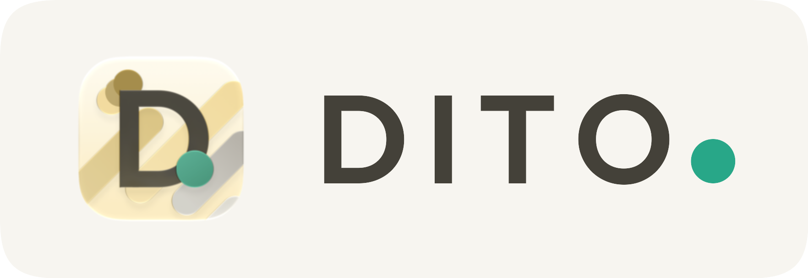
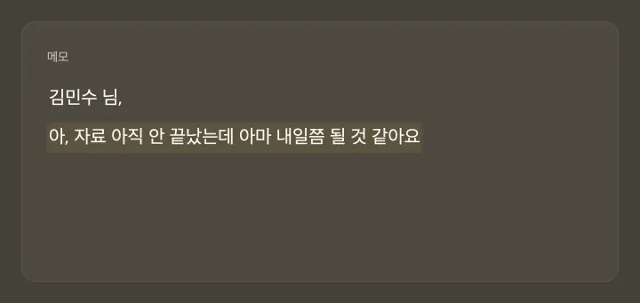
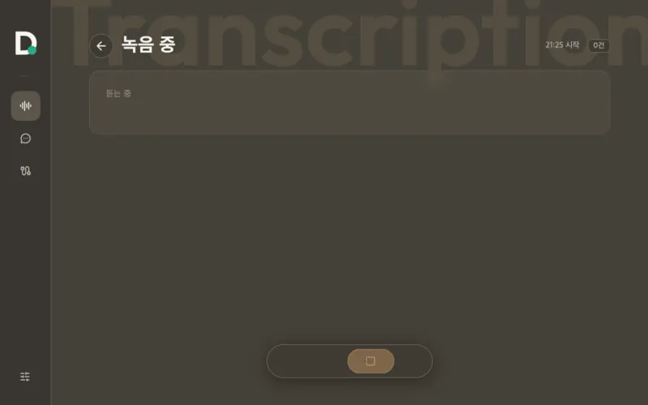
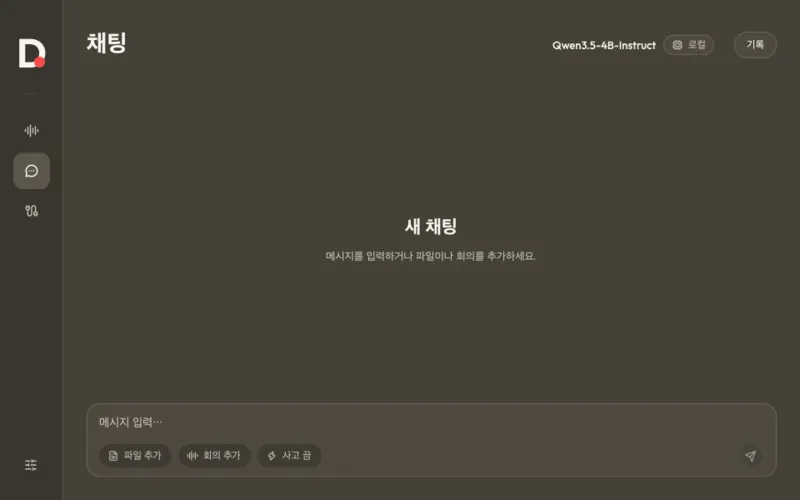

<p align="center">
  
</p>

<p align="center">
  <strong>로컬 모델을 우선 사용하는 macOS 음성 도우미</strong>
</p>

<p align="center">
  Language: <a href="README.md">English</a> / <a href="README.ja.md">日本語</a> / <a href="README.zh-CN.md">简体中文</a> / <strong>한국어</strong>
</p>

음성 입력, 문장 다듬기, 다시 쓰기, 번역, 요약, 답장 작성, 질의응답, 회의 받아쓰기를 지원하는 macOS 앱입니다.  
로컬 모델을 우선 사용하며, 기록과 오디오, 모델은 Mac에 저장됩니다.  
필요에 따라 클라우드 모델을 연결하거나 프롬프트를 수정할 수도 있습니다.

> [!NOTE]
> Dito는 현재 개발 초기 단계로, 빠르게 개선하고 있습니다. 아직 빌드된 설치 파일은 제공하지 않으므로 소스에서 직접 빌드해야 합니다. 아래 스크립트 하나로 빌드와 설치를 진행할 수 있습니다.

## 설치

Apple Silicon Mac과 macOS 13 이상이 필요합니다. 시스템 오디오 녹음은 macOS 14.6 이상에서 지원합니다.

### 빌드 환경

> [!TIP]
> 아래 개발 도구가 설치되어 있지 않다면 [Homebrew](https://brew.sh/)를 설치한 뒤 설치 스크립트를 실행하세요. 스크립트가 누락된 도구의 설치를 안내합니다.

1. [Rust](https://www.rust-lang.org/learn/get-started) 1.98 이상
2. CMake
3. [Apple 명령줄 도구](https://developer.apple.com/xcode/features/) (셰이더 컴파일 중 Metal 도구 모음을 찾을 수 없다는 오류가 나오면 `bash scripts/setup-macos.sh`를 실행하세요.)

### 빌드 및 설치

저장소 루트에서 실행합니다.

```bash
bash scripts/install-local.sh
```

## 주요 기능

### 1. 음성 입력

단축키를 누르고 말한 뒤 다시 누르면, Dito가 음성을 인식하고 문장을 다듬어 커서 위치에 입력합니다.

음성 인식 모델, 텍스트 모델, 단어장, 프롬프트를 설정하고 앱마다 별도의 다듬기 규칙을 지정할 수 있습니다.  
기존 업무 문서에서 고유 명사와 전문 용어를 추출해 단어장에 추가하면 인식 정확도를 높일 수 있습니다.

<p align="center"></p>

### 2. 명령

앱에서 텍스트를 선택하고 단축키를 누른 뒤 원하는 작업을 말합니다. 문장 다듬기, 다시 쓰기, 번역, 요약, 답장 작성, 질문을 처리할 수 있습니다.

소형 로컬 모델에 맞춰 학습한 분류기가 오프라인으로 명령의 종류를 판단합니다.  
말하기 어려운 상황에서는 HUD에 마우스 포인터를 올려 명령을 직접 입력할 수 있습니다.

<p align="center"></p>

### 3. 회의 받아쓰기

도구 창에서 Mac의 시스템 오디오, 마이크 또는 둘 다 녹음하며 실시간으로 텍스트를 생성합니다. 녹음이 끝나면 문맥에 맞게 문단을 다듬고 회의 제목을 자동으로 생성합니다. 문단은 바로 편집하거나 복사할 수 있습니다.

<p align="center"></p>

### 4. 채팅과 로컬 API

선택한 텍스트 모델로 채팅하고, 파일이나 녹음이 끝난 회의의 받아쓰기 내용을 첨부해 질문할 수 있습니다. 답변은 Markdown, 코드, 표를 포함해 스트리밍으로 표시됩니다. 로컬 모델을 선택하면 대화는 Mac 안에서 처리됩니다. 로컬 API를 켜면 OpenAI 호환 API와 MCP를 통해 같은 Mac의 다른 앱에서도 로컬 모델을 사용할 수 있습니다.

<p align="center"></p>

### 기타 기능

| | |
| --- | --- |
| **앱별 다듬기 규칙** | 언어별 공통 규칙에 앱별 규칙과 작성 예시를 추가할 수 있습니다 |
| **단어장** | 핫워드를 가져오거나 내보내고, 붙여넣은 텍스트나 파일, 다른 AI의 답변에서 등록할 용어 후보를 추출할 수 있습니다 |
| **로컬과 클라우드 조합** | 음성 인식과 텍스트 처리에 사용할 로컬 모델 또는 클라우드 설정을 각각 선택할 수 있습니다 |
| **기록과 재처리** | 다듬기에 실패하면 인식한 원문을 입력합니다. 결과와 녹음은 기록에 남아 다른 모델로 다시 인식하거나 다듬을 수 있습니다 |
| **통계와 다국어 UI** | 절약한 시간, 글자 수, 말하기 속도를 집계합니다. 한국어, 일본어, 영어, 중국어 간체와 번체, 몽골어, 프랑스어 등 7개 UI 언어를 지원합니다 |
| **로컬 저장** | 기록, 오디오, 모델은 Mac에 저장됩니다. 클라우드 API 키는 macOS 키체인에 보관하며 설정 파일에는 기록하지 않습니다 |

## 모델

> [!NOTE]
> 모든 로컬 모델은 Dito에서 필요할 때 다운로드하고 관리할 수 있습니다. 다운로드 이어받기와 다운로드 후 자동 무결성 검증을 지원합니다.

- 음성 인식 (ASR)
  - 로컬 모델
    - Qwen3-ASR 1.7B (기본값)
    - Qwen3-ASR 0.6B
    - SenseVoice Small
    - Haas-ja v1.0
    - Confucius4-R2T2
    - Fun-ASR-MLT-Nano-2512
    - Whisper large-v3
    - Whisper large-v3-turbo
    - Nemotron 3.5 Transcribe 30B-A4B
  - 클라우드 서비스
    - FunASR
    - Qwen ASR
    - OpenRouter
    - 사용자 지정 요청 (내장 JSON 편집기에서 설정)
- 텍스트 처리 (다듬기, 명령, 채팅)
  - 로컬 모델
    - Qwen3.5 Instruct 2B
    - Qwen3.5 Instruct 4B
    - Qwen3.5 Instruct 9B (기본값)
    - Qwen3.8 27B
  - 클라우드 서비스
    - Azure OpenAI
    - Amazon Bedrock
    - OpenAI 호환 API
- 발화 감지 (회의)
  - 로컬 모델
    - Silero VAD

## 개발

```bash
mise install                 # 고정된 버전의 Rust, Python, uv, ruff 설치
mise run dev:mock            # 모의 클라우드, 마이크, 데이터로 앱 실행
mise run dev                 # 실제 마이크, 모델, 서비스 제공자로 실행
mise run check               # 포맷 검사 및 빠른 테스트
mise run lint:rust           # clippy (mock 및 screenshots 기능 빌드 포함)
mise run readme:assets       # README 애니메이션 다시 생성 (screenshots 기능으로 먼저 빌드 필요)
```

Dito는 [GPUI](https://www.gpui.rs/) 기반의 Rust 워크스페이스입니다. UI는 `design/dito.figcraft`에서 먼저 설계하고, 코드는 그 설계에 맞춰 구현합니다.

| 목적 | 문서 |
| --- | --- |
| 빌드, 모의 실행, 테스트 | [docs/IMPLEMENTATION.md](docs/IMPLEMENTATION.md) |
| 로컬 실행, 플래그, 문제 진단 | [docs/DEBUGGING.md](docs/DEBUGGING.md) |
| 아키텍처와 설계 결정 | [docs/ARCHITECTURE.md](docs/ARCHITECTURE.md), [ADR](docs/adr/README.md) |
| 용어와 관련 구현 위치 | [docs/GLOSSARY.md](docs/GLOSSARY.md) |
| 기능과 설계 의도 | [design/features.md](design/features.md) |
| UI와 모션 설계 | [design/README.md](design/README.md) |
| AI 코딩 에이전트 작업 지침 | [AGENTS.md](AGENTS.md) |

## 라이선스

[MIT](LICENSE)
