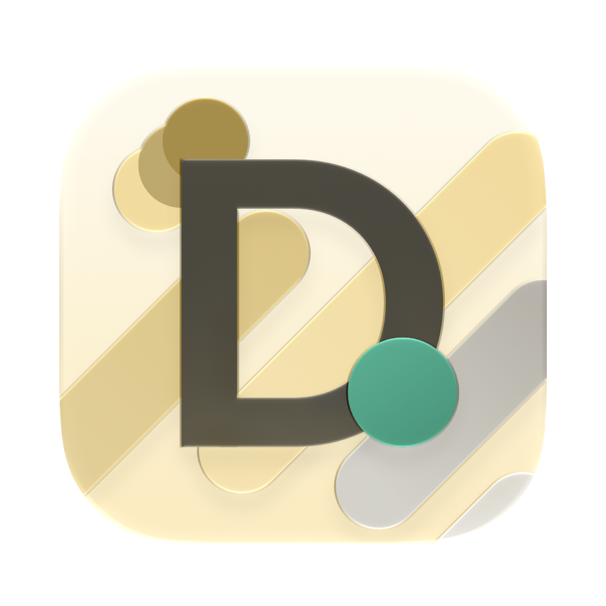
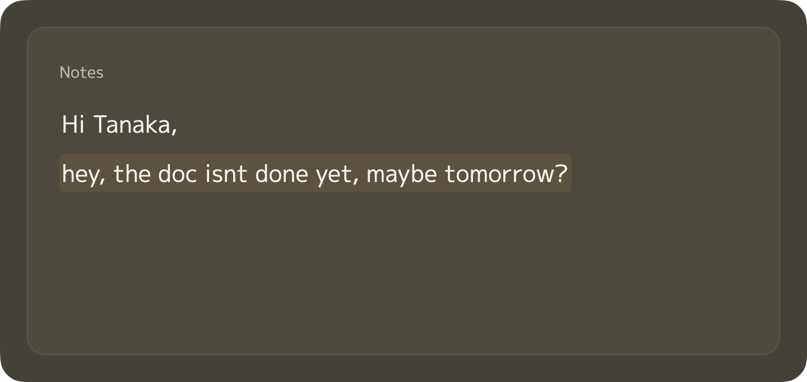
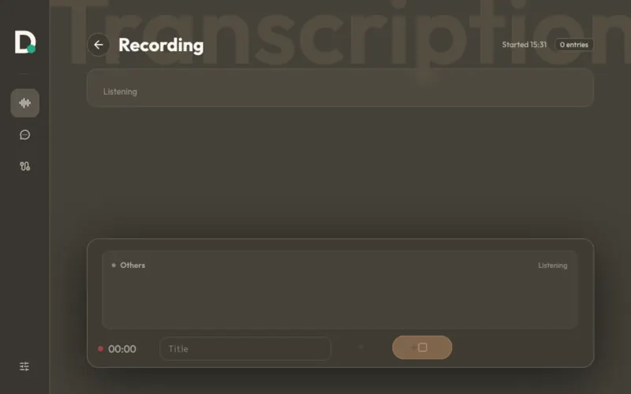
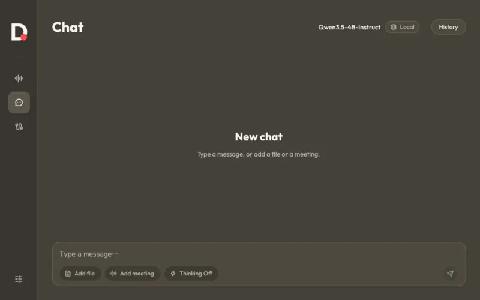

<p align="center">
  
</p>

<h1 align="center">Dito</h1>

<p align="center">
  <strong>Dictation for macOS. Press a shortcut, speak, and polished text appears at your cursor.</strong>
</p>

<p align="center">
  Language: <strong>English</strong> / <a href="README.ja.md">日本語</a> / <a href="README.zh-CN.md">简体中文</a>
</p>

Dito turns your voice into polished text and types it into whatever app has focus. Everything can run on your Mac, and nothing leaves it unless you choose a cloud provider. Dito is in early, fast-moving development.

## Install

**Download**: get the zipped app from the [latest release](../../releases/latest), move `Dito.app` to `Applications`, and open it. Requires an Apple Silicon Mac with macOS 13 or later (system audio transcription needs 14.6).

**Build from source**: in a checkout, run:

```bash
bash scripts/install-local.sh
```

The script checks CMake and Rust (installing them with Homebrew and rustup after asking), builds and signs the app with a local `dito-dev` identity, and installs it to `~/Applications/Dito.app`. Building needs the Xcode Command Line Tools and the Xcode Metal toolchain (`bash scripts/setup-macos.sh` installs it). Run the same command again after pulling an update. Details are in [INSTALL.md](INSTALL.md).

**Try it without touching your apps**: run against a mock cloud and a synthetic microphone with [mise](https://mise.jdx.dev/):

```bash
mise install
mise run dev:mock
```

**First launch**: Dito lives in the menu bar and opens no window by itself, except a short setup on the first run.

1. Allow **Microphone** and **Accessibility** when asked. Accessibility lets Dito type into other apps.
2. In **Models**, download a local model or add a cloud configuration.
3. Put the cursor in any text field, press the right **⌘** key, speak, and press it again.

<details>
<summary>Permissions after an update</summary>

Release builds are ad-hoc signed, so macOS asks for both permissions again after each update. Building from source with your own signing identity avoids this; see [docs/IMPLEMENTATION.md](docs/IMPLEMENTATION.md).

</details>

## What it does

### 1. Speak instead of type, in any app

Press the right ⌘, speak, and press it again. The speech is transcribed, polished, and typed at the cursor, by key input or paste with automatic fallback, and your clipboard is restored afterwards. A small capsule shows the live waveform and never takes focus. If polishing fails, the raw transcript is inserted; if there is nowhere to type, the text goes to the clipboard; every result stays in History.

<p align="center"></p>

### 2. Tell Dito what to do with selected text

Select text in any app, press ⇧ and the right ⌘, and say what you want: polish, rewrite, translate, summarize, reply, or ask a question. A rewrite replaces the selection; a reply or an answer opens a small window to confirm or copy. A command needs a local text model, which also decides what you asked for.

<p align="center"></p>

### 3. Transcribe a meeting

The Tools window records what your Mac plays (system audio, macOS 14.6 or later), your microphone, or both, and writes a transcript as people speak. Speech is cut into utterances by a voice activity model and recognized with the engine you chose for dictation. Each paragraph is polished with the two before it as context, and a finished meeting gets a short title. Paragraphs are editable, and a transcript can be copied as text.

<p align="center"></p>

### 4. Chat with a model on your Mac

Chat uses the text model you already run for polishing, so a conversation can stay on-device. Attach a file or a finished meeting transcript and ask about it; answers stream in with Markdown, code, and tables, and every conversation is kept in its history. The same models can be lent to other apps through an opt-in Local API on the loopback address, with an OpenAI-compatible endpoint and MCP.

<p align="center"></p>

## And the rest

| | |
| --- | --- |
| **Polishing that follows the app** | Separate writing styles for Slack, Teams, and any app you add, on top of shared rules per language |
| **Wordbook** | Words Dito should spell as written, passed to speech recognition as hotwords and optionally to polishing; import, export, and find words in pasted text or files |
| **Local or cloud, per stage** | On-device speech and text models, or your own cloud configurations from templates |
| **Never loses a dictation** | A failed polish inserts the transcript; silence and very short clips are dropped quietly |
| **Stays out of the way** | No window at launch, a HUD that never takes focus, Reduce Motion respected |
| **History and Stats** | Search, play back, re-transcribe, and re-polish earlier results; time saved, characters, and speaking speed |
| **Seven interface languages** | Japanese by default, with English, Simplified Chinese, Traditional Chinese, Korean, Mongolian, and French selectable |
| **Private by default** | History, audio, and models stay on your Mac; cloud API keys live in the macOS Keychain, never in files |

## Models

| Stage | On your Mac | In the cloud |
| --- | --- | --- |
| Speech recognition | Qwen3-ASR 1.7B (default) and 0.6B, SenseVoice Small, and optional downloads such as Whisper large-v3 | FunASR, Qwen ASR, OpenRouter, or your own request in a JSON editor |
| Text (polish, commands, chat) | Qwen3.5 Instruct 2B, 4B, and 9B | Azure OpenAI, Amazon Bedrock, or any OpenAI-compatible service |
| Speech detection (meetings) | Silero VAD | none |

Nothing downloads until you ask, and downloads resume and are verified.

## Use

| To | Do |
| --- | --- |
| Dictate | Press the right ⌘, speak, press it again |
| Cancel while recording | Esc or the × on the HUD |
| Finish early | The ✓ on the HUD |
| Stop transcription or polishing | The Stop button on the HUD |
| Dictate while holding the key | Choose Hold mode in **General** |
| Edit selected text by voice | Select it, press ⇧ and the right ⌘, say what to do |
| Open the Tools window | Control, Option, and T, or the menu bar icon |
| Teach Dito your words | **Wordbook** |
| Change how text is polished per app | **Prompts** |

Recordings stop after 5 minutes and are still processed. Settings, history, recorded audio, and downloaded models live in `~/Library/Application Support/com.fang2hou.Dito`.

## Development

```bash
mise install                 # Rust, Python, uv, and ruff at the pinned versions
mise run dev:mock            # whole app with mock cloud, microphone, and data
mise run dev                 # real microphone, models, and providers
mise run check               # format check and fast tests
mise run lint:rust           # clippy, also with the mock and screenshots features
mise run readme:assets       # regenerate the README animations
```

Dito is a Rust workspace on [GPUI](https://www.gpui.rs/). The UI design in `design/dito.figcraft` leads, and the code follows it.

| Goal | Read |
| --- | --- |
| Build, run with mocks, test | [docs/IMPLEMENTATION.md](docs/IMPLEMENTATION.md) |
| Run locally, flags, diagnose a problem | [docs/DEBUGGING.md](docs/DEBUGGING.md) |
| Architecture and decisions | [docs/ARCHITECTURE.md](docs/ARCHITECTURE.md), [ADRs](docs/adr/README.md) |
| Terms and where each concept lives | [docs/GLOSSARY.md](docs/GLOSSARY.md) |
| What the app does and why | [design/features.md](design/features.md) |
| UI and motion design | [design/README.md](design/README.md) |
| Work with an AI coding agent | [AGENTS.md](AGENTS.md) |

## Contributing

Branch from `develop` as `<type>/<kebab-name>`, open a pull request into `develop` with a Conventional Commit title, and run `mise run check` and `mise run lint:rust` first. The full flow is in [docs/CONTRIBUTING.md](docs/CONTRIBUTING.md).

## License

[MIT](LICENSE). Bundled fonts and icons keep their own licenses: IBM Plex Sans SC (`crates/dito-app/assets/fonts/IBMPlexSansSC-LICENSE.txt`) and Lucide (`crates/dito-app/assets/icons/LUCIDE-LICENSE.txt`). Downloaded models are governed by their own licenses.
