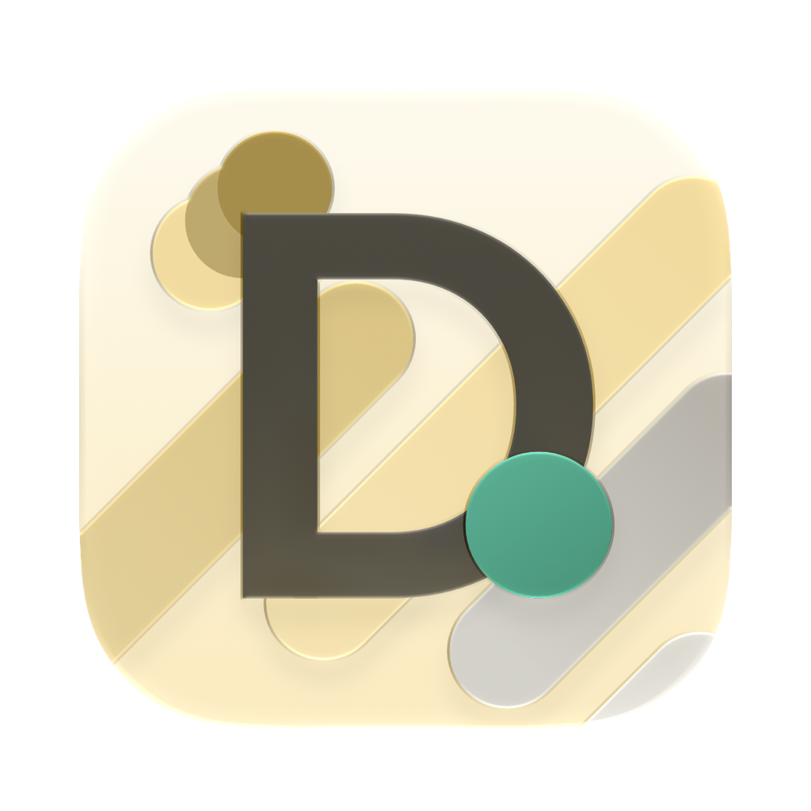
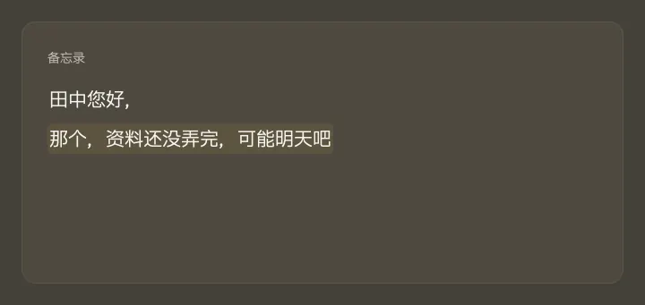
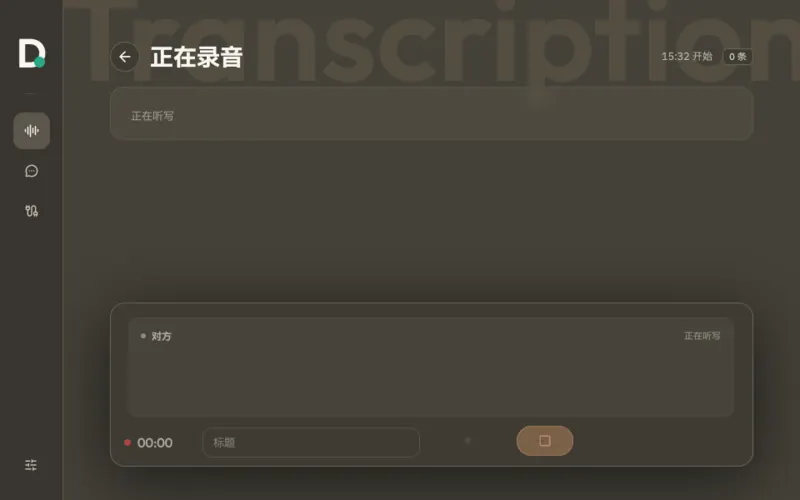
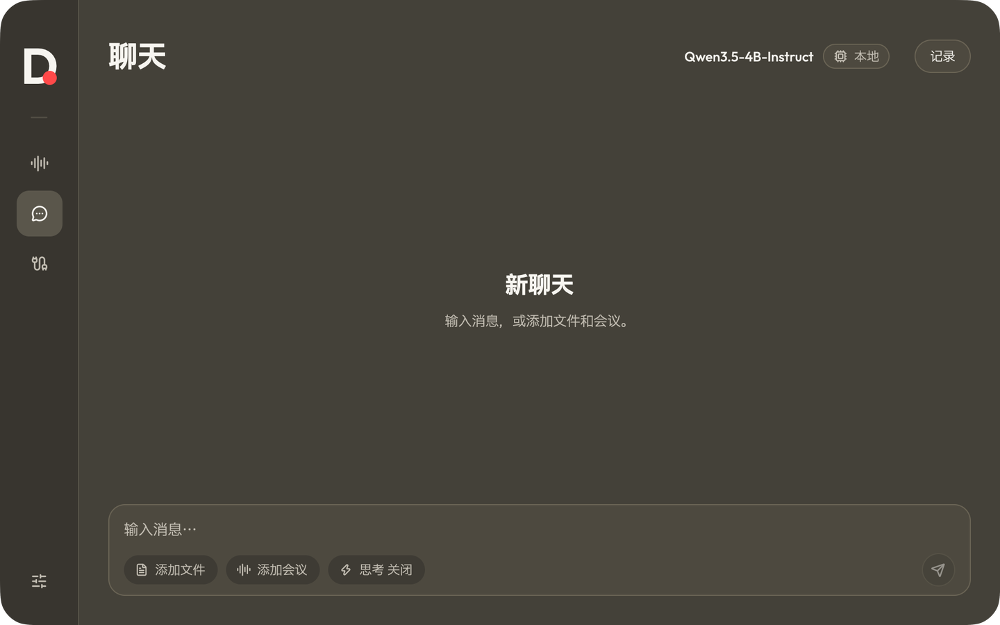

<p align="center">
  
</p>

<h1 align="center">Dito</h1>

<p align="center">
  <strong>macOS 语音输入应用：按下快捷键，开口说话，润色后的文字就会出现在光标处。</strong>
</p>

<p align="center">
  Language: <a href="README.md">English</a> / <a href="README.ja.md">日本語</a> / <strong>简体中文</strong>
</p>

Dito 把你的声音变成润色后的文字，直接输入到当前使用的应用里。全部流程都可以在 Mac 上完成，除非你选择云端服务，否则数据不会离开 Mac。Dito 还处于早期开发阶段，变化很快。

## 安装

**下载**：从[最新发布](../../releases/latest)下载 zip，把 `Dito.app` 移到“应用程序”并打开。需要 Apple 芯片的 Mac 和 macOS 13 或更高版本（系统音频转写需要 14.6）。

**从源码构建**：在代码仓库的目录里运行：

```bash
bash scripts/install-local.sh
```

脚本会检查 CMake 和 Rust（缺少时会先询问，再通过 Homebrew 和 rustup 安装），用本地的 `dito-dev` 签名身份构建并签名，然后安装到 `~/Applications/Dito.app`。构建需要 Xcode 命令行工具和 Xcode 的 Metal 工具链（运行 `bash scripts/setup-macos.sh` 即可安装）。拉取更新后，再运行一次同样的命令。详情见 [INSTALL.md](INSTALL.md)。

**不影响其他应用的试用方式**：用 [mise](https://mise.jdx.dev/)，连接模拟的云端和合成的麦克风运行：

```bash
mise install
mise run dev:mock
```

**首次启动**：Dito 常驻菜单栏，除了第一次运行时的简短设置外，不会自己打开窗口。

1. 按提示允许**麦克风**和**辅助功能**。辅助功能用于让 Dito 向其他应用输入文字。
2. 在**模型**里下载本地模型，或添加云端配置。
3. 把光标放在任意文本框里，按下右 **⌘** 键，说话，再按一次。

<details>
<summary>更新后的权限</summary>

发布版使用临时（ad-hoc）签名，所以每次更新后，macOS 会再次询问这两项权限。用自己的签名身份从源码构建可以避免这一点，见 [docs/IMPLEMENTATION.md](docs/IMPLEMENTATION.md)。

</details>

## 能做什么

### 1. 在任何应用里，用说话代替打字

按下右 ⌘，说话，再按一次。语音会被识别、润色，并输入到光标处。输入时会在按键输入和粘贴之间自动切换，完成后恢复剪贴板。一个小胶囊显示实时波形，但不会抢走焦点。润色失败时会直接输入识别出的原文，没有地方可输入时会复制到剪贴板，所有结果都保留在历史里。

<p align="center"></p>

### 2. 用语音告诉 Dito 怎么处理选中的文字

在任何应用里选中文字，按 ⇧ 加右 ⌘，说出想做什么：润色、改写、翻译、总结、回复或提问。改写会替换选中的内容，回复和回答会在一个小窗口里供你确认或复制。命令需要本地文本模型，也由它判断你的指令是什么意思。

<p align="center"></p>

### 3. 转写会议

“工具”窗口可以录制 Mac 播放的声音（系统音频，需要 macOS 14.6 或更高版本）、麦克风，或两者同时录制，并边说边生成转写文本。语音由语音检测模型切分成片段，再用你为语音输入选的同一个识别引擎识别。每个段落会以前面两个段落为上下文进行润色，结束后的会议会得到一个简短的标题。段落可以就地编辑，转写内容也可以复制为文本。

<p align="center"></p>

### 4. 和 Mac 上的模型聊天

聊天直接使用你用于润色的文本模型，所以整场对话可以不离开设备。你可以附上文件或已结束会议的转写内容再提问，回答会以流式显示，支持 Markdown、代码和表格，每段对话都会保留在历史里。同一批模型还可以通过本地回环地址上的可选“本地 API”借给其他应用，提供兼容 OpenAI 的接口和 MCP。

<p align="center"></p>

## 其他功能

| | |
| --- | --- |
| **按应用润色** | 在每种语言的通用规则之上，为 Slack、Teams 和你添加的任何应用分别设置文风 |
| **单词本** | 你希望按原样书写的词，会作为热词传给语音识别，也可以传给润色；支持导入、导出，也能从粘贴的文字或文件里找词 |
| **每个环节可选本地或云端** | 设备上的语音识别和文本模型，或者用模板创建的云端配置 |
| **不丢失任何一次输入** | 润色失败时输入识别出的原文；无声或极短的录音会被悄悄丢弃 |
| **不碍事** | 启动时不开窗口，HUD 不抢焦点，并遵循“减少动态效果”设置 |
| **历史与统计** | 可检索、回放、重新识别和重新润色之前的结果；还能看到节省的时间、字数和语速 |
| **七种界面语言** | 默认日语，可切换为英语、简体中文、繁體中文、한국어、Монгол 和 Français |
| **默认私密** | 历史、音频和模型都留在你的 Mac 上；云端 API 密钥保存在 macOS 钥匙串里，不会写入文件 |

## 模型

| 环节 | 在 Mac 上 | 在云端 |
| --- | --- | --- |
| 语音识别 | Qwen3-ASR 1.7B（默认）和 0.6B、SenseVoice Small，以及 Whisper large-v3 等可选下载 | FunASR、Qwen ASR、OpenRouter，或用 JSON 编辑器写你自己的请求 |
| 文本（润色、命令、聊天） | Qwen3.5 Instruct 2B、4B、9B | Azure OpenAI、Amazon Bedrock，或任何兼容 OpenAI 的服务 |
| 语音检测（会议） | Silero VAD | 无 |

只有你提出要求时才会下载，下载可以续传并会校验。

## 使用

| 想做的事 | 操作 |
| --- | --- |
| 语音输入 | 按右 ⌘，说话，再按一次 |
| 录音时取消 | Esc，或 HUD 上的 × |
| 提前结束 | HUD 上的 ✓ |
| 停止识别或润色 | HUD 上的中止按钮 |
| 按住键才录音 | 在**通用**里选择“按住” |
| 用语音编辑选中的文字 | 选中文字，按 ⇧ 加右 ⌘，说出要做什么 |
| 打开“工具”窗口 | Control、Option 加 T，或菜单栏图标 |
| 让 Dito 记住你的专有词 | **单词本** |
| 按应用调整润色方式 | **提示词** |

录音会在 5 分钟后停止，已录下的内容仍会被处理。设置、历史、录音和下载的模型都在 `~/Library/Application Support/com.fang2hou.Dito`。

## 开发

```bash
mise install                 # 按固定版本安装 Rust、Python、uv 和 ruff
mise run dev:mock            # 用模拟的云端、麦克风和数据运行整个应用
mise run dev                 # 使用真实的麦克风、模型和服务商
mise run check               # 格式检查和快速测试
mise run lint:rust           # clippy（也包含带 mock 和 screenshots 功能的构建）
mise run readme:assets       # 重新生成 README 里的动画
```

Dito 是基于 [GPUI](https://www.gpui.rs/) 的 Rust 工作区。界面先在 `design/dito.figcraft` 里设计，代码再跟进。

| 目的 | 阅读 |
| --- | --- |
| 构建、用模拟环境运行、测试 | [docs/IMPLEMENTATION.md](docs/IMPLEMENTATION.md) |
| 本地运行、命令行参数、排查问题 | [docs/DEBUGGING.md](docs/DEBUGGING.md) |
| 架构与决策 | [docs/ARCHITECTURE.md](docs/ARCHITECTURE.md)、[ADR](docs/adr/README.md) |
| 术语以及各概念所在位置 | [docs/GLOSSARY.md](docs/GLOSSARY.md) |
| 应用做什么、为什么 | [design/features.md](design/features.md) |
| 界面与动效设计 | [design/README.md](design/README.md) |
| 与 AI 编程助手协作 | [AGENTS.md](AGENTS.md) |

这些文档是英文的。

## 参与贡献

从 `develop` 创建名为 `<type>/<kebab-name>` 的分支，以 Conventional Commit 格式的标题向 `develop` 提交 pull request，提交前先运行 `mise run check` 和 `mise run lint:rust`。完整流程见 [docs/CONTRIBUTING.md](docs/CONTRIBUTING.md)。

## 许可证

[MIT](LICENSE)。随附的字体和图标保留各自的许可证：IBM Plex Sans SC（见 `crates/dito-app/assets/fonts/IBMPlexSansSC-LICENSE.txt`）和 Lucide（见 `crates/dito-app/assets/icons/LUCIDE-LICENSE.txt`）。下载的模型适用各自的许可证。
