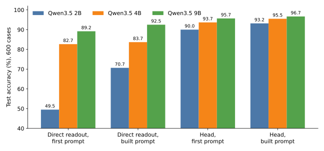
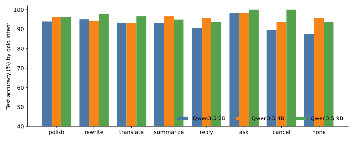
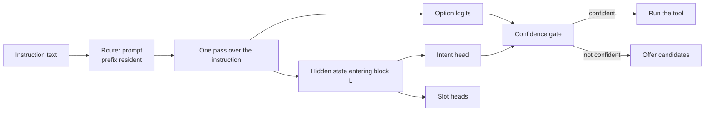
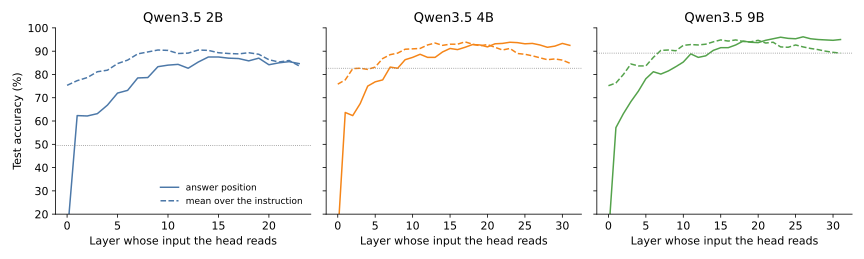
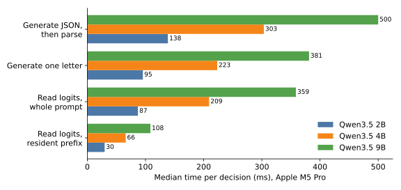
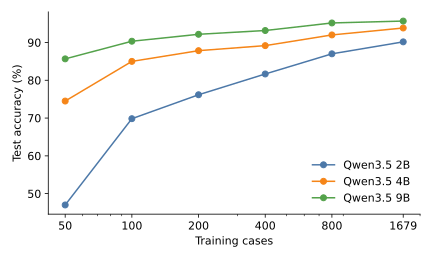

# Intent routing for voice commands

Command mode needs a router: the user selects text, speaks an instruction about it, and one of eight intents is chosen before any tool runs. This bench measures how well the chat model the user already loaded can make that choice without generating a token, and how much a small fitted head on its hidden states adds.

Measured on 2026-11-12 on an Apple M5 Pro with the Qwen3.5 2B, 4B and 9B files of Dito's catalog (Q4_K_M GGUF) and the llama.cpp tree of `llama-cpp-sys-2` 0.1.160, the one Dito links. How the result is built into the app is in [docs/INTENT_ROUTING.md](../docs/INTENT_ROUTING.md).

The bench first routed six intents (`reply` and `ask` did not exist: a question was `none`, and a reply was a rewrite or a summary). Its numbers are kept at the end as history. Everything else in this document is the eight-intent work: a new test set, a new training set, a new prompt, refitted heads. The training set has had two rounds: round 1 (1375 cases after the filter) and round 2 (1679, with 306 cases aimed at the errors of round 1). The numbers below are round 2, the heads in the app; [Round 1 against round 2](#round-1-against-round-2) compares them with the same prompt and the same test set.

## Result

One prompt pass decides. Nothing is generated and nothing is parsed.



| Model | Direct readout, first prompt | Direct readout, shipped prompt | Head, first prompt | Head, shipped prompt |
| --- | ---: | ---: | ---: | ---: |
| Qwen3.5 2B | 49.5% | 70.7% | 90.0% | **93.2%** |
| Qwen3.5 4B | 82.7% | 83.7% | 93.7% | **95.5%** |
| Qwen3.5 9B | 89.2% | 92.5% | 95.7% | **96.7%** |

600 test cases, 200 each in Chinese, Japanese and English. The heads were fitted on 1679 separately written training cases, and every choice was made on training data.

1. **The head is the largest lever.** A linear layer on hidden states of a middle block takes the 2B from 49.5% to 90.0% on the first prompt. Reading the option logits alone does not make any of the three a router for eight intents; a head does.
2. **Prompt construction helps the direct readout and adds a little under a head.** The 2B direct readout goes from 49.5% to 70.7% (186 cases won, 59 lost) and the 9B from 89.2% to 92.5% (34 won, 14 lost, p = 0.0055). The 4B does not change significantly (82.7% to 83.7%, p = 0.63). With a head the shipped prompt adds 3.2, 1.8 and 1.0 points on the 2B, 4B and 9B.
3. **The confidence can gate execution.** At a threshold of 0.9 the 9B runs 90.3% of instructions directly and 99.3% of those are right (4 wrong of 542). The 4B runs 86.5% at 98.5% (8 wrong of 519) and the 2B 81.2% at 98.8% (6 wrong of 487). The rest go to candidate buttons.
4. **The two new intents are learned as well as the old ones.** On the 4B head, `reply` scores 95.8% and `ask` 98.3%; the weakest intents are `translate` (93.3%) and `cancel` (93.8%). On the 2B the weakest are `none` (87.5%), `cancel` (89.6%) and `reply` (90.6%).
5. **It is four to five times faster than generating and parsing, with the same accuracy.** On the 4B, generating JSON takes 303 ms at 82.2%; the direct readout with a resident prefix takes 66 ms at 82.7%.
6. **More training data did not move the test score.** The round 2 set has 22% more cases, aimed at the errors of round 1. Against round 1 the test accuracy differs by +0.4, 0.0 and +0.4 points on the 2B, 4B and 9B, none significant (McNemar p from 0.80 to 1.00); the 2B gains on `reply` and `summarize`.

The app path (`dito-core` heads applied by `dito-runtimes` on the loaded model) on the same 600 cases:

| Model | Accuracy | Auto share | Auto accuracy | Auto wrong | p50 | p95 | Largest probability difference from numpy |
| --- | ---: | ---: | ---: | ---: | ---: | ---: | ---: |
| Qwen3.5 2B | 93.2% | 81.2% | 98.8% | 6 | 36 ms | 41 ms | 0.0042 |
| Qwen3.5 4B | 95.5% | 86.5% | 98.5% | 8 | 75 ms | 88 ms | below 0.00001 |
| Qwen3.5 9B | 96.7% | 90.3% | 99.3% | 4 | 120 ms | 135 ms | below 0.00001 |

Times are per decision with the router's prompt prefix resident: prompt rendering, tokenization, one pass over the instruction and the echoed copy, and the heads (`results/intent/apple-m5-pro/production.json`). They were taken on an otherwise idle machine; the same runs made while other builds were running read 48, 125 and 169 ms at p50, so compare times only between quiet runs. The prompt is 1383 tokens at the median (it was 824 with six intents) and costs nothing per decision: the 2B, 4B and 9B took 34, 72 and 118 ms with six. The 2B head pools over the instruction's tokens, where the app's pass and the recorded probe run differ by up to 0.0042 in probability; the top answer is the same in all 600 cases.

By language, shipped heads (accuracy, zh, ja, en): 2B 95.5, 94.0, 90.0; 4B 98.5, 93.0, 95.0; 9B 98.0, 95.0, 97.0.

### Per intent



Accuracy by gold intent, shipped prompt with the selected head (the number of test cases in brackets):

| Model | polish (84) | rewrite (144) | translate (60) | summarize (60) | reply (96) | ask (60) | cancel (48) | none (48) |
| --- | ---: | ---: | ---: | ---: | ---: | ---: | ---: | ---: |
| 2B | 94.0 | 95.1 | 93.3 | 93.3 | 90.6 | 98.3 | 89.6 | 87.5 |
| 4B | 96.4 | 94.4 | 93.3 | 96.7 | 95.8 | 98.3 | 93.8 | 95.8 |
| 9B | 96.4 | 97.9 | 96.7 | 95.0 | 93.8 | 100.0 | 100.0 | 93.8 |

The direct readout of the shipped prompt, for comparison: on the 4B, `reply` 84.4, `ask` 86.7, `polish` 71.4 and `translate` 68.3; on the 9B `ask` is 100.0 and `polish` 85.7. A head repairs the intents the prompt leaves uneven.

### Boundary pairs

The pairs where the labeling rules (`data/intent/GUIDE.md`) draw a close line. A cell counts test cases of one side that the router read as the other side's intent, shipped heads:

| Boundary | Side | 2B | 4B | 9B |
| --- | --- | ---: | ---: | ---: |
| `reply` and `rewrite` | `reply` read as `rewrite` (of 96) | 2 | 1 | 2 |
| | `rewrite` read as `reply` (of 144) | 1 | 2 | 1 |
| `reply` and `ask` | `reply` read as `ask` (of 96) | 2 | 2 | 2 |
| | `ask` read as `reply` (of 60) | 0 | 0 | 0 |
| `ask` and `none` | `ask` read as `none` (of 60) | 0 | 0 | 0 |
| | `none` read as `ask` (of 48) | 1 | 1 | 1 |
| `rewrite` (shorten) and `summarize` | `rewrite` with a shorten action read as `summarize` (of 39) | 2 | 1 | 0 |
| | `summarize` read as `rewrite` (of 60) | 0 | 0 | 0 |
| `polish` and `rewrite` | `polish` read as `rewrite` (of 84) | 4 | 1 | 2 |
| | `rewrite` read as `polish` (of 144) | 2 | 2 | 1 |

The boundary pairs account for 14 of the 41 errors of the 2B, 10 of 27 of the 4B and 9 of 20 of the 9B. The rest are spread thinly: the full confusion matrix of each model is in `results/intent/apple-m5-pro/summary.md`. The largest single cells are `reply` read as `translate` (3 on the 2B, 2 on the 9B), `cancel` read as `reply` (3 on the 2B) and `none` read as `polish` or `reply` (2 each on the 2B). `intent confusion` prints these tables.

### Round 1 against round 2

Same router prompt, same 600 test cases, heads fitted on the training set of each round: round 1 on 1375 cases, round 2 on 1679 (306 new cases aimed at multi-request pairs in both orders, replies without a word for replying, "reply in a language" against translate, polishing one's own reply draft, gist against detail, short cancels and actions on a reply). "Won" counts cases only round 2 gets right. `intent rounds` prints these tables from `results/intent/apple-m5-pro/round1/`.

| Model | Round | Accuracy | Auto share | Auto accuracy | Auto wrong | Won | Lost | McNemar p |
| --- | ---: | ---: | ---: | ---: | ---: | ---: | ---: | ---: |
| 2B | 1 | 92.8 | 79.3 | 98.5 | 7 | | | |
| 2B | 2 | 93.2 | 81.2 | 98.8 | 6 | 14 | 12 | 0.845 |
| 4B | 1 | 95.5 | 85.5 | 99.2 | 4 | | | |
| 4B | 2 | 95.5 | 86.5 | 98.5 | 8 | 6 | 6 | 1.000 |
| 9B | 1 | 96.3 | 92.0 | 99.1 | 5 | | | |
| 9B | 2 | 96.7 | 90.3 | 99.3 | 4 | 9 | 7 | 0.804 |

Accuracy by gold intent, round 1 then round 2 (cases won, cases lost against round 1):

| Intent | 2B | 4B | 9B |
| --- | --- | --- | --- |
| polish (84) | 95.2 → 94.0 (1, 2) | 96.4 → 96.4 (0, 0) | 96.4 → 96.4 (1, 1) |
| rewrite (144) | 95.8 → 95.1 (2, 3) | 95.1 → 94.4 (0, 1) | 97.2 → 97.9 (3, 2) |
| translate (60) | 96.7 → 93.3 (0, 2) | 93.3 → 93.3 (1, 1) | 96.7 → 96.7 (0, 0) |
| summarize (60) | 88.3 → 93.3 (3, 0) | 96.7 → 96.7 (1, 1) | 95.0 → 95.0 (1, 1) |
| reply (96) | 85.4 → 90.6 (7, 2) | 95.8 → 95.8 (1, 1) | 91.7 → 93.8 (3, 1) |
| ask (60) | 100 → 98.3 (0, 1) | 96.7 → 98.3 (2, 1) | 100 → 100 (0, 0) |
| cancel (48) | 87.5 → 89.6 (1, 0) | 93.8 → 93.8 (0, 0) | 97.9 → 100 (1, 0) |
| none (48) | 91.7 → 87.5 (0, 2) | 95.8 → 95.8 (1, 1) | 97.9 → 93.8 (0, 2) |

Boundary pairs, test cases read as the neighbour, round 1 then round 2 (2B, 4B, 9B):

| Boundary | Side | 2B | 4B | 9B |
| --- | --- | --- | --- | --- |
| `reply` and `rewrite` | `reply` read as `rewrite` | 5 → 2 | 1 → 1 | 2 → 2 |
| | `rewrite` read as `reply` | 1 → 1 | 2 → 2 | 2 → 1 |
| `reply` and `ask` | `reply` read as `ask` | 1 → 2 | 1 → 2 | 2 → 2 |
| | `ask` read as `reply` | 0 → 0 | 1 → 0 | 0 → 0 |
| `ask` and `none` | `ask` read as `none` | 0 → 0 | 1 → 0 | 0 → 0 |
| | `none` read as `ask` | 1 → 1 | 1 → 1 | 0 → 1 |
| `rewrite` (shorten) and `summarize` | `rewrite` (shorten) read as `summarize` | 1 → 2 | 1 → 1 | 0 → 0 |
| | `summarize` read as `rewrite` | 0 → 0 | 0 → 0 | 2 → 0 |
| `polish` and `rewrite` | `polish` read as `rewrite` | 3 → 4 | 1 → 1 | 1 → 2 |
| | `rewrite` read as `polish` | 3 → 2 | 1 → 2 | 1 → 1 |

Out-of-fold errors on the training set, round 1 then round 2: 2B 132 of 1375 (90.4% right), then 137 of 1679 (91.8%); 4B 85 (93.8%) then 91 (94.6%); 9B 73 (94.7%) then 69 (95.9%). The two sets differ, so this is not a like-for-like score. On the 306 new cases alone, the out-of-fold error rate is 5.9%, 4.2% and 4.2%; on the 1373 older cases it is 8.7%, 5.7% and 4.1%.

What round 2 did and did not change:

- **The 2B gains where the new cases aimed:** `reply` 85.4% to 90.6% (7 cases won, 2 lost), `summarize` 88.3% to 93.3%, and `reply` read as `rewrite` falls from 5 to 2. It loses a little on `none` and `translate`.
- **The 4B and the 9B were already at the level the labels allow.** Their per-intent changes are within two cases either way. The 9B gains on `reply` (91.7% to 93.8%) and `cancel` (97.9% to 100%) and loses on `none` (97.9% to 93.8%, 2 cases).
- **The remaining test errors are mostly the cases the data cannot decide:** misheard intent words and instructions that name two of polish, rewrite and summarize. Both are in the out-of-fold groups below.
- **A larger share of the instructions is now run directly on the 2B and 4B** (81.2% and 86.5%, up from 79.3% and 85.5%), but the 4B has more wrong among them (8 against 4, in 519 against 513): within noise, and worth watching.

## Method



| Layer | What it does | Fitted | To replace it |
| --- | --- | --- | --- |
| Prompt | Option list, rules, keywords, examples | No | Text only; heads must be refitted |
| Readout | One pass; option logits and hidden states | No | A llama.cpp call |
| Head | A matrix on the hidden state, then a softmax | Yes, tens of seconds on CPU | One file (about 0.2 MB for the 4B intent head) |
| Gate | Run when the top probability is high enough | One threshold | One number |

The direct readout follows [SemIf](https://github.com/TheoLeeCJ/SemIf): the prompt lists lettered options and the logits of those letters at the answer position are read. A head is `softmax((W * ((x − mean) / scale) + b) / T)`.

Terms used below:

| Term | Meaning |
| --- | --- |
| Answer position | The last prompt token; its output is the next-token distribution |
| `last` | A hidden state taken at the answer position |
| `span` | The mean of the hidden states over the instruction's tokens |
| Layer `l` | The residual stream entering block `l` (llama.cpp `llama_set_embeddings_layer_inp`) |
| Auto share | Share of cases whose top probability is at least 0.9 |
| Auto accuracy | Accuracy among those cases |
| ECE | Expected calibration error, 10 bins |
| Out-of-fold | Predicted by a fit that did not see the case (5 folds inside the training data) |
| First prompt | Variant `base` |
| Shipped prompt | Variant `rules_kw_fewshot_echo`, the text of `crates/dito-core/src/intent/router_system.txt` |

## Data and rules of evidence

| Data | Cases | Use |
| --- | ---: | --- |
| `data/intent/test.json` | 600 (200 per language) | Frozen. Reports only. SHA-256 starts with `1bcb2807`. Eight intents, an instruction card per case |
| `data/intent/train/*.json` | 1684 written, 1679 after the filter | Fits heads; chooses prompt, layer and temperature. Round 1 was 1380 written (the `*-a`, `*-b` and `*-c` files, less two ambiguous cases removed since), round 2 added the `*-d` files |

The eight intents, in option order, and the test cases per language:

| Intent | Meaning | Test cases per language |
| --- | --- | ---: |
| `polish` | Fix errors and flow without changing purpose, register or length much | 28 |
| `rewrite` | Change length, tone, format, audience or wording on purpose | 48 |
| `translate` | Another language or written variety, also when combined with other changes | 20 |
| `summarize` | The gist: summary, key points, one line | 20 |
| `reply` | The selection was received and the user wants a response to send back, or help with what to say | 32 |
| `ask` | A question that expects an answer, about the text or about anything else | 20 |
| `cancel` | The user calls it off, including after first asking for something | 16 |
| `none` | An action Dito cannot do, chit-chat, dictated content, garbled output | 16 |

Everything about the two sets (precedence, boundaries, the instruction card, tags, counts, the quality bar) is in the one guide, [data/intent/GUIDE.md](data/intent/GUIDE.md).

- The slot labels of the test set come from its cards: a rewrite's op is the last of its actions (the training guide's rule for two ops; 38 of the 144 test rewrites have two or more), a translate's target is its one action. The training set carries them as `slots`.
- Loading drops 1 training case whose character bigrams overlap a test case of the same language by 75% or more, and 4 repeats. None equals a test case in other words (the same counts for round 1).
- Training set composition: polish 240, rewrite 340, translate 186, summarize 190, reply 294, ask 125, cancel 143, none 161 (round 1: 216, 306, 156, 154, 192, 107, 113, 131). By tag: 542 ASR errors, 486 with fillers, 274 multi-request, 240 questions, 181 self-corrections, 149 polite, 116 with a negation, 97 retractions, 96 code-mixed.
- Every choice (layer, pooling, L2 strength, temperature, mix weight) looks only at out-of-fold loss on training data. The prompt construction is the one that won the six-intent sweep (below), checked again on training data and not changed between the two training rounds. The test set is read once per configuration.
- Differences come with the cases won and lost and an exact McNemar p-value. With 600 test cases one point is 6 cases.
- A stored probe run is retaken when its cases or its prompt changed: the stored requests are compared with the current ones.

## Main results

| Model | Stage | Accuracy | ECE | Auto share | Auto accuracy | Auto wrong | zh | ja | en |
| --- | --- | ---: | ---: | ---: | ---: | ---: | ---: | ---: | ---: |
| 2B | Direct readout, first prompt | 49.5 | 0.077 | 8.0 | 87.5 | 6 | 54.5 | 42.5 | 51.5 |
| 2B | Direct readout, shipped prompt | 70.7 | 0.030 | 22.7 | 94.9 | 7 | 76.0 | 67.0 | 69.0 |
| 2B | Head, first prompt | 90.0 | 0.019 | 73.7 | 97.5 | 11 | 93.5 | 90.5 | 86.0 |
| 2B | Head, shipped prompt | 93.2 | 0.017 | 81.2 | 98.8 | 6 | 95.5 | 94.0 | 90.0 |
| 4B | Direct readout, first prompt | 82.7 | 0.028 | 50.3 | 98.0 | 6 | 86.0 | 77.0 | 85.0 |
| 4B | Direct readout, shipped prompt | 83.7 | 0.034 | 53.2 | 97.2 | 9 | 87.5 | 78.5 | 85.0 |
| 4B | Head, first prompt | 93.7 | 0.019 | 84.5 | 98.8 | 6 | 98.0 | 90.5 | 92.5 |
| 4B | Head, shipped prompt | 95.5 | 0.016 | 86.5 | 98.5 | 8 | 98.5 | 93.0 | 95.0 |
| 9B | Direct readout, first prompt | 89.2 | 0.061 | 53.2 | 98.4 | 5 | 93.0 | 87.5 | 87.0 |
| 9B | Direct readout, shipped prompt | 92.5 | 0.024 | 72.8 | 98.6 | 6 | 95.5 | 92.5 | 89.5 |
| 9B | Head, first prompt | 95.7 | 0.016 | 90.5 | 98.9 | 6 | 98.0 | 93.0 | 96.0 |
| 9B | Head, shipped prompt | 96.7 | 0.012 | 90.3 | 99.3 | 4 | 98.0 | 95.0 | 97.0 |

A "Head" row is the candidate selected by training out-of-fold loss, not the best one on the test set. Every candidate is in `results/intent/apple-m5-pro/summary.md`. With the round 2 data the selected candidate also has the highest test accuracy among the candidates on the shipped prompt for all three models; with round 1 it did not (the best 9B candidate scored 96.8% against the selected 96.3%).

What was selected on the shipped prompt, which is what the app bundles:

| Model | Selected | Intent head reads |
| --- | --- | --- |
| 2B | Head alone | Layer 14 `last` and layer 15 `span` |
| 4B | Head alone | Layer 19 `last` and layer 17 `span` |
| 9B | Head alone | Layer 20 `last` and layer 18 `span` |

No candidate mixes the direct readout in round 2: the 9B mix at weight 0.7 has out-of-fold loss 0.124 against 0.122 for the head alone. The mix is log-linear: `p ∝ exp(w * ln p_head + (1 − w) * ln softmax(option_logits / T))`. Round 1 selected a head on one layer for the 2B and the 4B, and a head on layer 28 mixed at weight 0.9 for the 9B.

The selection looks only at out-of-fold loss, and in round 2 it prefers heads that read two different layers over a head on both readings of one layer, by 0.003 to 0.007 in loss (for example 0.180 against 0.183 on the 4B). Each extra layer the readout keeps costs time; the same-layer candidates score 93.0%, 94.8% and 96.5% on the 2B, 4B and 9B, against 93.2%, 95.5% and 96.7% for the selected ones. The shipped heads were measured on an idle machine at 36, 75 and 120 ms (above), the same as round 1's heads on the 4B (79 ms in a run made next to it), so the cost is small.

Accuracy by tag, direct readout on the first prompt and head on the shipped prompt (the number of test cases in brackets):

| Model | asr_error (156) | self_correction (79) | multi_request (74) | negation (46) | retraction (32) | code_mix (47) | filler (231) | polite (37) | question (112) |
| --- | ---: | ---: | ---: | ---: | ---: | ---: | ---: | ---: | ---: |
| 2B | 46.8 → 89.1 | 32.9 → 86.1 | 39.2 → 87.8 | 65.2 → 97.8 | 0.0 → 87.5 | 72.3 → 97.9 | 49.8 → 93.9 | 56.8 → 94.6 | 29.5 → 95.5 |
| 4B | 75.6 → 91.7 | 68.4 → 94.9 | 75.7 → 95.9 | 87.0 → 100 | 78.1 → 100 | 89.4 → 97.9 | 81.4 → 96.5 | 91.9 → 91.9 | 73.2 → 94.6 |
| 9B | 81.4 → 93.6 | 84.8 → 92.4 | 91.9 → 95.9 | 100 → 97.8 | 96.9 → 100 | 95.7 → 100 | 94.4 → 97.0 | 89.2 → 97.3 | 89.3 → 98.2 |

ASR errors remain the hardest shape: 89.1% to 93.6% against 93.9% to 98.2% for the filler and question cases. All nine tags for all four stages are in `summary.md`.

## Prompt construction (4B, direct readout)

Each variant flips one switch. The training set (1679, round 2) chooses; the test set (600) reports. The shipped variant is the construction that won the six-intent sweep: decision rules, keywords in three languages, examples, the instruction stated twice. For eight intents the rules grew a precedence for `reply`, two rules for questions and a list of close calls between neighbouring intents, and the examples grew from twelve to eighteen.

| Variant | Prompt tokens | Train accuracy | Test accuracy | Test: ASR error | Test: self-correction | Test: multi-request |
| --- | ---: | ---: | ---: | ---: | ---: | ---: |
| `base`, the first prompt | 327 | 78.7 | 82.7 | 75.6 | 68.4 | 75.7 |
| `base_kw`: keywords in three languages after each option | 664 | 82.8 | 86.8 | 82.1 | 73.4 | 74.3 |
| `rules`: the decision order as eight rules and close calls | 726 | 76.3 | 79.5 | 72.4 | 67.1 | 67.6 |
| `base_fewshot`: eighteen examples | 615 | 80.5 | 84.2 | 76.3 | 69.6 | 77.0 |
| `base_echo`: the instruction stated twice | 359 | 79.9 | 83.7 | 78.2 | 67.1 | 86.5 |
| `base_cue`: a lead-in prefilled in the answer | 333 | 80.0 | 82.7 | 76.9 | 69.6 | 81.1 |
| `base_rev`: options in reverse order | 327 | 80.2 | 80.2 | 74.4 | 68.4 | 70.3 |
| `base_digits`: options numbered | 327 | 72.8 | 73.7 | 62.2 | 64.6 | 67.6 |
| `base_optlast`: options after the instruction | 330 | 78.6 | 77.8 | 75.0 | 58.2 | 85.1 |
| `compact`: shortest option descriptions | 222 | 71.6 | 71.8 | 64.7 | 58.2 | 70.3 |
| `rules_kw` | 1063 | **83.8** | 85.8 | 78.8 | 73.4 | 74.3 |
| `rules_kw_echo` | 1095 | 82.4 | 85.5 | 76.9 | 69.6 | 79.7 |
| `rules_kw_fewshot` | 1351 | 83.1 | 84.2 | 74.4 | 74.7 | 70.3 |
| `rules_kw_fewshot_echo`, shipped | 1383 | 83.0 | 83.7 | 73.7 | 70.9 | 77.0 |

- **The six-intent ranking did not repeat for the direct readout.** With six intents the full construction was best on training data (86.9%). With eight intents and the round 1 data keywords alone led (`base_kw`, 84.7% against 82.9% for the full construction); with the round 2 data `rules_kw` leads (83.8%), `rules_kw_fewshot_echo` is third at 83.0% and `base_kw` second at 82.8%. On the test set the full construction scores 83.7% against 86.8% for `base_kw`. The rules alone lose 2.4 points on training data against the first prompt, and the rules with the echo lose 4.5.
- **The shipped construction stays because the head, not the readout, decides in the app.** Under a head the shipped prompt has the lower out-of-fold loss and the higher test accuracy than the first prompt on all three models (round 2: 0.254, 0.180 and 0.122 against 0.336, 0.240 and 0.183; 93.2%, 95.5% and 96.7% against 90.0%, 93.7% and 95.7%). A check with hidden states on the 4B with the round 1 data, for the two keyword variants that led on training data, gave the same order: out-of-fold loss of the selected head 0.197 for the shipped prompt, 0.214 for `rules_kw`, 0.230 for `base_kw` and 0.250 for `base`, and test accuracy 95.5%, 95.7%, 94.0% and 94.2%. `rules_kw` was within the noise on the test set (3 cases in 600). The check was not repeated for round 2, because the prompt stays fixed between the two rounds.
- **Keyword anchors work best again.** Keywords in three languages after each option lift ASR errors from 75.6% to 82.1%.
- **Option descriptions must stay.** The shortest form loses 7.1 points on training data. Prompt length costs nothing at run time (see Efficiency), so there is no reason to trim.
- **Options go before the instruction.** After it, accuracy drops 5 points and self-corrections fall to 58%.
- **Option order is a bias of its own.** Reversing the options loses 2.5 points with the first prompt, and gains a few with the rules prompts. Averaging both orders takes two passes and does not beat the forward order for the shipped prompt (83.7% both ways, 13 won and 13 lost; `results/intent/apple-m5-pro/option_order.qwen3.5-4b.md`).
- **The effect depends on the model.** The shipped prompt adds 21.2 points to the 2B direct readout, 1.0 to the 4B (not significant) and 3.3 to the 9B.

## Model structure and the layer a head reads

Qwen3.5 is architecture `qwen35` in llama.cpp (from the GGUF metadata):

| | 2B | 4B | 9B |
| --- | ---: | ---: | ---: |
| Blocks | 24 | 32 | 32 |
| Hidden size | 2048 | 2560 | 4096 |
| Full attention interval | 4 | 4 | 4 |

Every fourth block is full attention; the other three are gated delta net blocks, a linear attention with recurrent state. Two engineering constraints follow:

- The model's memory mixes an attention cache with recurrent state and cannot drop the tail of a sequence. A resident prefix has to be reused by copying the sequence. The probe checks the copy against a full decode of its first request on every run.
- llama.cpp can return the input of any block from an ordinary pass, so hidden states need no second pass. The kept rows exist for the last batch only, and the prompt prefix is now longer than one batch of 1024 tokens: the probe decodes its prefix and its reference pass in chunks (`Llama::decode_chunked`), as the app's readout does.



Solid lines read the answer position, dashed lines the mean over the instruction, the dotted gray line is the direct readout. First prompt.

| Model | Blocks | Best layer, `last` | Accuracy | Best layer, `span` | Accuracy | Final layer, `last` |
| --- | ---: | ---: | ---: | ---: | ---: | ---: |
| 2B | 24 | 14 | 87.5 | 9 | 90.5 | 84.7 |
| 4B | 32 | 23 | 93.8 | 17 | 94.0 | 92.5 |
| 9B | 32 | 26 | 96.2 | 15 | 94.8 | 95.0 |

- **The intent is formed by the middle of the network.** Reading the mean over the instruction's tokens, the three models peak at layers 9, 17 and 15, which is 38%, 53% and 47% of their depth.
- **The information is there before the answer position uses it.** The gap is largest on the 2B: 49.5% from the logits of the first prompt, 90.5% from the instruction tokens of the same pass at layer 9.
- **The shipped heads read `last` and `span` together**, from two layers each: 14 and 15 on the 2B, 19 and 17 on the 4B, 20 and 18 on the 9B.

## More from the same pass: slot heads

Once a tool is chosen it needs arguments. Two more heads read the hidden states of the same pass:

| Task | Classes | Train | Test | Majority class | 2B | 4B | 9B |
| --- | ---: | ---: | ---: | ---: | ---: | ---: | ---: |
| `rewrite.op`: expand, shorten, formal, casual, format, paraphrase, audience | 7 | 340 | 144 | 19.4 | 80.6 | 81.9 | 73.6 |
| `translate.target`: en, ja, zh, zh-Hant, ko, other | 6 | 186 | 60 | 25.0 | 88.3 | 78.3 | 86.7 |

Shipped prompt, round 2 data (round 1: `rewrite.op` 79.9, 83.3 and 83.3, `translate.target` 85.0, 76.7 and 90.0). On the first prompt `rewrite.op` scores 80.6, 81.2 and 77.8 and `translate.target` 81.7, 78.3 and 76.7.

- `rewrite.op` reaches 74% to 82% and is bundled with the app. It scored about 94% in the six-intent round, on a test set whose op labels were set by hand per case; here the label of a case with two actions is its last, and many instructions carry two ("shorter and more formal"), so the same head is judged by a stricter rule. The 9B's head fell from 83.3% to 73.6% with the round 2 data (the head reads layer 31 `last`, chosen by out-of-fold loss on 340 cases); it is the weakest of the three, and the decision carries the op only as a hint: the rewrite tool reads the instruction itself.
- `translate.target` has 186 training cases for six classes and 60 test cases. The three models range from 78.3% to 88.3%, which 60 cases cannot rank. It is reported and not bundled; the translate tool reads the instruction itself.
- Further slots (a reply's stance: accept, decline, ask back, thanks, given) are one more matrix each, once training cases carry them. The test cards have the label; the training data does not.

## Efficiency: reading versus generating



Same model, same first prompt (327 tokens), same 600 cases:

| Model | Path | Accuracy | Output tokens | p50 | p95 |
| --- | --- | ---: | ---: | ---: | ---: |
| 2B | Generate JSON, then parse | 50.2 | 6.5 | 138 ms | 160 ms |
| 2B | Generate one letter | 49.5 | 1 | 95 ms | 103 ms |
| 2B | Direct readout, whole prompt | 49.5 | 0 | 87 ms | 90 ms |
| 2B | Direct readout, resident prefix | 49.5 | 0 | 30 ms | 32 ms |
| 4B | Generate JSON, then parse | 82.2 | 6.3 | 303 ms | 359 ms |
| 4B | Generate one letter | 82.7 | 1 | 223 ms | 228 ms |
| 4B | Direct readout, whole prompt | 82.7 | 0 | 209 ms | 214 ms |
| 4B | Direct readout, resident prefix | 82.7 | 0 | 66 ms | 69 ms |
| 9B | Generate JSON, then parse | 89.3 | 6.3 | 500 ms | 602 ms |
| 9B | Generate one letter | 89.2 | 1 | 381 ms | 387 ms |
| 9B | Direct readout, whole prompt | 89.2 | 0 | 359 ms | 364 ms |
| 9B | Direct readout, resident prefix | 89.2 | 0 | 108 ms | 113 ms |

- **Reading is about 4.6 times faster than generating JSON** with the prefix resident, and as accurate (the JSON path is within 0.7 points, in either direction). None of the 1800 JSON generations failed to parse.
- **A resident prefix removes prompt length from the cost.** The shipped prompt is 1383 tokens; with the prefix resident only the instruction and its echo are decoded. That is why keywords, rules and examples are free at run time.
- **Reading also returns the whole distribution.** Generation returns one answer and no usable confidence.

## How much training data



| Training cases | 2B | 4B | 9B |
| ---: | ---: | ---: | ---: |
| 50 | 47.0 | 74.5 | 85.7 |
| 100 | 69.8 | 85.0 | 90.3 |
| 200 | 76.2 | 87.8 | 92.2 |
| 400 | 81.7 | 89.2 | 93.2 |
| 800 | 87.0 | 92.0 | 95.2 |
| 1679 | 90.2 | 93.8 | 95.7 |

First prompt, a head on both readings of one layer, round 2 data. The curves flatten: from 800 to 1679 cases the 9B gains 0.5 points and the 4B 1.8; the 2B depends on data most and gains 3.2. Round 1 reached 90.0%, 93.8% and 95.5% on the 2B, 4B and 9B with its 1375 cases, so the extra 304 cases moved the first-prompt head by +0.2, 0.0 and +0.2. The six-intent round's 4B head reached 94.3% at 868 cases on an easier test.

## Where the training data hurts

Every training case is scored by a head that never saw it (out-of-fold, shipped prompt, selected head); `intent oof` lists them in `results/intent/apple-m5-pro/oof_errors.md`. Round 2: the 2B misses 137 of 1679 (91.8% right), the 4B 91 (94.6%) and the 9B 69 (95.9%); round 1 missed 132 of 1375, 85 and 73. In the 4B's misses 57 of 91 (63%) carry the `asr_error` tag, against 32% of the whole set (542 of 1679). By cause, with the round 1 counts in brackets:

| Cause | Pattern | Misses, 2B, 4B, 9B |
| --- | --- | --- |
| Polish, rewrite and summarize overlap | "make it shorter and fix the grammar", "uh this is just for our team chat so fix the punctuation and make it more relaxed", "my manager needs this for next weak, make it formal and then boil it down to three points", "ちょっと短くしてから要点出して": the labels follow precedence rule 4 (summarize beats rewrite, rewrite beats polish) and the head reads one of the two requests | 61, 37 and 22 (66, 35, 30) |
| The word that carries the request is misheard | `闰色`, `经简`, `高性`, `要訳`, `can you pole ish this`, `reward this sentence`, `for get it`: another intent word is at least as likely as the intended one | 85, 57 and 48 carry `asr_error` (85, 59, 54) |
| A self-correction or a negation names two intents | "要約して、あ、やっぱり校正だけで", "summarize it no no polish it", "不用翻译了，直接总结": the final request is not always the one the head picks | 18, 21 and 7 carry `self_correction`; with `negation` 31, 26 and 13 (43, 26, 14) |
| A reply that does not say "reply" | "了解ですとだけね", "谢谢王老师给的建议", "我今儿发烧起不来床了，嗯说我今天来不了", "会議は明日に変更って知らせて": read as `none`, `rewrite` or `polish` | reply cases missed: 21, 14 and 14 (16, 13, 12); read as `none` or `rewrite`: 8, 6 and 8 (7, 9, 6) |
| A reply and a second request | "um write a reply to this and then translate it into French", "这条你先帮我回一下，再翻成英文": rule 4 says reply wins, the head says translate | 2, 2 and 3 reply cases read as `translate` |
| Another intent read as a reply | "さっきの以来の件で部長への返事なんだけど、変な日本語ないか見て" (polish a draft reply), "not right now", "for get it" | 20, 11 and 12 |
| A cancel that carries content words | "write a reply to this, uh actually never mind", "translate this into japanese cancel that", "expand this, no forget it", and a bare `算了` | 15, 7 and 5 (12, 6, 5) |
| A none that looks like a request, a retraction or a question | "rewrite this no actually just delete the whole paragraph", "帮我把这段删了吧", a long dictated thank-you note | 6, 4 and 6 (7, 3, 3) |
| A gist asked as a question | "えーと、この長いお知らせ結局何なの", "management posted this in the haul, what's this long notice even about": `summarize` read as `ask` | 1 to 2 per model |

24 training cases are missed by all three models (33 in round 1), for example `en-ta093`, `ja-ta149`, `zh-ta084`, `en-tc018` and `en-td008`, which points at the labels and the words, not at one head. The cases added in round 2 are missed less often than the older ones on the 2B and 4B (5.9% and 4.2% against 8.7% and 5.7%) and as often on the 9B (4.2% against 4.1%). What they did not fix:

- **Two requests, the rule of precedence.** The new multi-request pairs help `reply` and `summarize` on the 2B. Several new cases that ask for a rewrite first and a summary after (`en-td010`, `ja-td010`, `zh-td010`, `zh-td013`) are still read as `rewrite` by at least one model, and `en-td008` (fix the punctuation, make it more relaxed: rewrite) as `polish` by all three. Each pair needs more cases in each order and in each language.
- **A reply with nothing in the sentence that says reply.** The new bare replies ("了解ですとだけね", "谢谢王老师给的建议") are still read as `none` because dictated content and a bare reply are close: the difference lies in the selection, which the router does not see.
- **Misheard intent words** are untouched by design: the data can only teach the model to prefer one reading of a sound over another, and `for get it` or `can you pole ish this` are decided by the rest of the sentence.

## Tried and not kept

| Approach | Source | Outcome |
| --- | --- | --- |
| Temperature scaling of the direct readout, one parameter | Common practice | Accuracy unchanged; the auto share moves either way |
| Batch calibration: subtract the mean log-probability over unlabeled inputs | Zhou et al., 2024 | No consistent gain: 4B shipped prompt 83.7 → 86.3 (p = 0.052), 9B 92.5 → 91.8, 2B 70.7 → 70.2 |
| A head on the eight option logits | The six-intent round of this bench | 75.5, 89.8 and 92.5 on the shipped prompt, below every hidden-state head; too little information |
| Averaging two option orders | After Zheng et al., 2024 | Two passes, not better than the original order for the shipped prompt |
| A lead-in prefilled in the answer | Common prefill technique | Slightly more accurate on training data, much less confident (test auto share 50% → 27% on the first prompt) |
| Numbered options, options after the instruction, short descriptions | Prompt variants | All worse |

## Prior work used

| Work | Used for |
| --- | --- |
| [SemIf](https://github.com/TheoLeeCJ/SemIf) | Reading option logits and reusing the prompt prefix |
| Zhao et al., [Calibrate Before Use](https://arxiv.org/abs/2102.09690), ICML 2021 | Models favor some answers a priori and need calibration |
| Zheng et al., [Large Language Models Are Not Robust Multiple Choice Selectors](https://arxiv.org/abs/2309.03882), ICLR 2024 | Bias from option letters and order |
| Zhou et al., Batch Calibration (arXiv:2309.17249), ICLR 2024 | The batch calibration row above |
| [Layer by Layer: Uncovering Hidden Representations in Language Models](https://arxiv.org/abs/2502.02013), ICML 2025 | Middle layers beat the last one; reproduced in the layer scan |
| Springer et al., [Repetition Improves Language Model Embeddings](https://arxiv.org/abs/2402.15449), ICLR 2025 | Repeating the input improves representations of causal models; the `echo` variants |
| Leviathan et al., [Prompt Repetition Improves Non-Reasoning LLMs](https://arxiv.org/abs/2512.14982) | The same |
| Zhang et al., [Tell Your Model Where to Attend (PASTA)](https://arxiv.org/abs/2311.02262), ICLR 2024 | Steering attention toward a span. Not implemented; a later experiment |

## Limits

- **The data is synthetic.** Test and training sets were written by a language model from one guide, and their ASR errors are imagined. Real speech errs differently, and two sets from one source make the gains look better than they will be. A set of real transcripts has to be measured before command mode ships.
- **600 test cases.** The 95% interval of 96.7% is roughly 95.0% to 97.9%. Differences of one or two points between models or configurations are not conclusions, and per-intent figures rest on 48 to 144 cases.
- **A head is bound to a model file and a prompt.** Another quantization, checkpoint or prompt needs a refit.
- **One machine.** Times are for the M5 Pro.
- **No selection context.** "Make this natural business English" is a translation or a rewrite depending on the language of the selected text, and "reply" presumes the selection is something received; the router sees neither.
- **The context fits two copies of the prefix.** The decision context holds the resident prefix and one request's copy in 4096 tokens. The prompt is 1383 tokens, so a prompt of about 1900 tokens or more needs a larger context in `dito-runtimes`.

## History: the six-intent round

The six-intent round routed `polish`, `rewrite`, `translate`, `summarize`, `cancel` and `none` on 300 test cases (100 per language) with 868 training cases. It is not comparable with the numbers above: the test set was easier (a question was `none`, and a reply did not exist), and it is gone from the pipeline. Its result, for the record: the shipped heads scored 94.7%, 94.7% and 97.7% on the 2B, 4B and 9B with 89% to 96% of instructions run directly at 98.2% to 99.0%; the shipped prompt had been chosen on training data among 18 variants. Its data and result files are removed; they stay in the git history of `data/` and `results/intent/`.

## Running

```bash
mise run bench intent all                                  # everything below, in order, for the three models
mise run bench intent decide -m qwen3.5-2b "转成烦体中文"    # one decision through the app path
```

The models are read from Dito's own model folder (`~/Library/Application Support/com.fang2hou.Dito/models`); download them in the app first. Nothing is downloaded by the bench. `intent run` also takes `--gguf <file>` with one model. The full run takes about 90 minutes on the M5 Pro, most of it the prompt sweep. Take the timing of the app path (`intent parity`) with nothing else building or running models: a busy machine makes it up to 60% slower.

| Command | What it does | Needs the model |
| --- | --- | --- |
| `intent run -m <model> -v <variants> -s train test [--layers all] [--full] [--generate letter\|json]` | Probe runs into `cache/intent/`; a run that exists and matches the cases and the prompt is skipped | Yes |
| `intent fit [-m <models>] [-v <variants>]` | Fits every candidate head on the training split, scores it on the test split, writes the fit report | No |
| `intent export [-m <models>]` | Fits the shipped prompt again from the stored runs and writes the selected heads to `crates/dito-core/src/intent/heads/`, without the other reports | No |
| `intent parity [-m <models>]` | Runs the 600 test cases through the app path, compares it with numpy, writes `production.json` | Yes |
| `intent decide -m <model> "<instruction>" ...` | Decides instructions through the app path | Yes |
| `intent sweep`, `intent order`, `intent efficiency`, `intent errors` | Prompt variants, option order, reading versus generating, misclassified test cases | No |
| `intent confusion`, `intent oof`, `intent rounds` | Boundary pairs and confusion matrix on the test set; out-of-fold errors on the training set; round 1 against the current round | No |
| `intent summary`, `intent charts` | The tables and charts quoted here | No |
| `intent all [-m <models>]` | All of the above in order, writing every file under `results/intent/<chip>/` | Yes |

Model keys are `qwen3.5-2b`, `qwen3.5-4b` and `qwen3.5-9b`; the default is all three. Every command is run as `mise run bench intent ...` from the repository root.

What is stored where:

| Path | Content | Committed |
| --- | --- | --- |
| `cache/intent/<chip>/<model>/<variant>.<mode>/` | Every probe run: requests, option logits, timings, hidden states (several GB for the full set) | No, local only and git-ignored. `all` recomputes what is missing |
| `results/intent/<chip>/<model>.<variant>.json` | Fit reports: every candidate, the layer scan, slot heads, the learning curve, the selected head's out-of-fold predictions | Yes |
| `results/intent/<chip>/summary.md`, `oof_errors.md` and the other tables and charts | What this document quotes | Yes |
| `results/intent/<chip>/production.json` | Accuracy and timing of the app path | Yes |
| `results/intent/<chip>/round1/` | The selected head's test probabilities and out-of-fold predictions of round 1, the baseline of `intent rounds` | Yes |
| `../crates/dito-core/src/intent/heads/<catalog id>.heads` | The heads the app bundles. Committed build inputs: a build of the app never refits | Yes |

The code is split by role under `src/dito_bench/intent/`: `probe/` (the runner and the run cache), `train/` (heads, fit, export, the `.heads` format, parity: everything that produces the bundled heads), `experiments/` (prompt sweep, option order, efficiency, rounds, learning curve, errors) and `report/` (tables, summary, confusion, out-of-fold errors, charts); `pipeline.py` is `intent all`. The data is `data/intent/`: `test.json`, `train/` and `GUIDE.md`. A probe run is valid while its stored requests equal the current ones, which are built from the case texts and the prompt only, so the cache does not depend on where the data files are.

Two Rust programs do the model work. `crates/dito-runtimes/examples/intent_probe` is the experiment instrument: it records option logits and hidden states for any prompt variant. `crates/dito-runtimes/examples/intent_decide` runs the app's own code (`dito_local::intent::decide`), so `parity` measures what ships.
