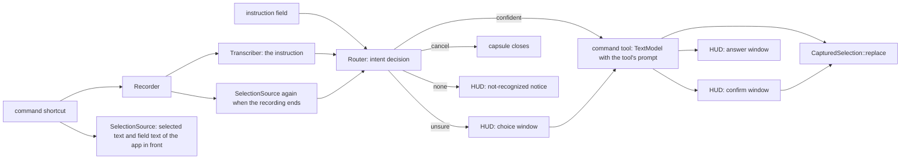
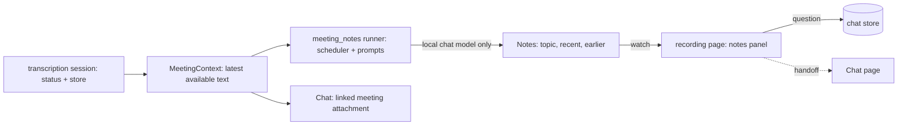

# Architecture

Terms are defined in [GLOSSARY.md](GLOSSARY.md). This document keeps the design of the code from drifting, especially during broad changes by AI agents. It names modules and boundaries, not files. Revisit it when the architecture changes, not on routine edits.

## Overview

Dito is a macOS dictation app. A global shortcut starts a recording; the audio is transcribed (locally or by a cloud provider), optionally polished by a language model, and typed into the app that has focus. A floating HUD shows the progress; a settings window, a Tools window (meeting transcription, chat, and the Local API), a menu bar item and an onboarding wizard surround it. The code is a Cargo workspace: a platform-free core, macOS adapters, local model runtimes and a GPUI app on top.

## Codebase Map

- `dito-core`: config, i18n, prompts, the dictation controller and pipeline, meeting transcription, chat, the loopback Local API and MCP server, the audio clip and its WAV encoding, cloud providers, the SQLite store (history, wordbook, stats, transcripts, chats), the secrets trait, the text insertion policy, and intent routing for voice commands (router prompt, fitted heads, decision; see [INTENT_ROUTING.md](INTENT_ROUTING.md)).
- `dito-audio`: microphone and system audio capture, resampling to 16 kHz mono, device transport detection.
- `dito-local`: local model catalog, downloads, model state and the local engines; runtimes plug in through `RuntimeLoader`.
- `dito-runtimes`: llama.cpp (Metal), sherpa-onnx and transcribe.cpp bindings, plus managed NeMo-Speech.cpp and Prism llama-server workers, behind `dito-local`'s traits. Process-backed models use the same catalog and lifecycle; the app owns and stops their workers.
- `dito-platform`: macOS integration: event tap and shortcut machine, permissions, text insertion, Keychain, music mute, window helpers, login item.
- `dito-testkit`: an in-process mock server for cloud APIs and downloads.
- `dito-ui`: generic GPUI controls, motion, typography and color tokens, with no dependency on another workspace crate.
- `dito-app`: the GPUI app: HUD, settings pages, the Tools window, onboarding, menu bar, theme, and the app-bound `ui` facade over `dito-ui`.

## Dictation Flow

The controller owns the run: it starts the recorder, hands the clip to the pipeline, delivers the text through `Sink` and records the result in `Store`. Polish failure skips the polish step and delivers the transcript. A transcript, and a polished text once more, gets a wordbook term written as the term where it is spelled as it sounds (`one on one` becomes `1on1`) or where it says one of the spoken forms the user entered for it (`meeting` or `ミーティング` becomes `MTG`), with any engine and whether polish is on or off (`spoken_forms`). A spoken form the user entered may be scoped to Japanese, English or Chinese, and then applies only when ASR reported the transcript in that language: a transcript ASR reported in another language takes only forms for every language, and one without a reported language is read by its script (`spoken_forms_lang`). It matches in either ASCII case with a space, a hyphen or a no-break space interchangeable, at the edge of a word unless it starts or ends with Japanese, Chinese or Korean characters, and it wins over a derived rule on the same span. A term already written is left alone, also when one of its forms is the start of it. A derived rule comes from the shape of the term, so it covers terms with a digit or a symbol (`1on1`, `24/7`, `C++`) and mixed-case words (`macOS`), not katakana or plain words (`Claude`, `Visual Studio`), and stays beside the entered ones: with `ワンオンワン` entered for `1on1`, `one on one` is still written as `1on1`. A meeting utterance gets the same before it is grouped into paragraphs, each meeting paragraph again after its polish, and so does a history entry that is polished again. The app only observes `HudState` and sends commands.

While the user speaks, the controller gets the cloud engines of the run ready (`Engines::warm_up`), so the requests that follow the recording start on a built engine and an open connection instead of paying for the name lookup and the TCP and TLS handshakes after the last word. The warm-up starts 450 ms after the shortcut went down (`WARM_UP_DELAY`), when a press that was typing has already ended its recording: the shortcut machine reports a typing chord within 400 ms. It builds the cloud speech engine and the cloud polish engine the settings select, both at once, and opens a connection to the host of each (`Transcriber::preconnect`, `TextModel::preconnect`): reqwest opens a connection only for a request, so each engine sends `HEAD /` with no key, no audio and no text and ignores the answer ([ADR 0008](adr/0008-data-stays-local.md)). The task belongs to the recording: it stops when the recording ends, finished or cancelled, it reports nothing to the actor, and a failure in it is only a line in the `dito_trace` log, so a run never waits for it and never fails because of it. A command recording warms up the same way.

What the warm-up leaves alone: a local engine, because asking for one loads its model and when a model loads is not for a recording to decide ([ADR 0002](adr/0002-local-first.md)); the connection of a Bedrock engine, which the AWS SDK opens only for a signed call (the engine itself is built); and every path without a recording in front of it, which are a retry, meeting transcription, chat and polishing a history entry again.

## Command Flow

A second shortcut starts a command instead of a dictation. The same controller actor owns it and the same HUD shows it, in blue.

How a run ends, by intent:

| Intent | Ending |
| --- | --- |
| polish, rewrite, translate | The result replaces the selection (the confirm window first when `confirm_before_replace` is on). With nothing selected the HUD asks for the text and the result is inserted at the cursor. A selection that cannot be edited (a preview, a web page, a read-only view) is never written over: the result waits in the confirm window with Copy only, whatever the setting. An editable selection whose write fails still ends with the gold Copied outcome |
| summarize | Confirm window, then Replace (over the selection, or at the cursor when nothing was selected); Copy only when the selection cannot be edited |
| reply | Confirm window with Close and Copy only (`ResultWrite::CopyOnly`): the reply is never written over the message it answers, and Copy is the primary action. With nothing selected the HUD asks for the text it replies to |
| ask | Answer window with Copy and OK. Selected text is what the question is about; with nothing selected the question stands on its own and is answered from general knowledge |
| cancel | The capsule closes, recorded as cancelled |
| none | No tool runs. The capsule shows the not-recognized notice (`HudState::NotRecognized`), recorded as closed, not as a failure |

A likeliest intent of none shows the notice whether or not the decision passed the confidence gate. The notice follows the error capsule's rules (hides after `ERROR_LINGER`, hover keeps it, either shortcut starts a new run) without its red or its buttons. The choice window offers reply and ask like the other tools, and never cancel or none.

The shortcut machine reports a press and the core decides what it means. When the command shortcut is the dictation shortcut plus modifiers and the extra keys follow within the chord window, the machine reports a handover (`ShortcutToCommand`) instead of an abort and a second press, and the actor turns the recording that just started into a command run in place: same recording, same run id, the selection captured at that moment, the HUD switched through `RunKind`. Recording never waits for that decision, but the capsule does when a handover is possible: the app sends `KeyDownMayHandOver` instead of `KeyDown` when the command shortcut is the dictation shortcut plus modifiers (`dictation_may_hand_over`), and the actor starts recording, sets the run kind and the timers as usual but keeps the HUD at `Hidden` for `CHORD_HOLD` (150 ms, `motion/chord-hold`). A handover inside the wait reveals the capsule already as a command, so it pops in blue and never gold; the wait ending first (`Msg::RevealCapsule`, guarded by the epoch like the other timers) reveals the dictation capsule, and a handover after that fades the visible capsule's colors over the hover duration (the HUD view, from the run-kind change). A typing chord, a cancel or Esc inside the wait ends the recording with no capsule at all, and a toggle press or hold release inside the wait goes straight to the processing capsule. The dictation shortcut's key-to-handover gap is logged as `chord_gap_ms` in the `dito_trace` log, to tune the wait. A command shortcut press itself never waits. A typing chord is its own message (`ChordAbort`) that only drops a recording the press started; in toggle mode a press of either shortcut finishes a listening run, and the handover or chord messages that follow it find no recording and do nothing.

The router decides on the local chat model without generating ([INTENT_ROUTING.md](INTENT_ROUTING.md)); the tool then generates with the same model. When the tool needs text and nothing is selected, the HUD asks for it and the result is inserted at the cursor through `Sink`.

The recorder starts before the first reading, so a slow reading never clips the first words. The selection is read when the capsule opens (the buttons and the trace need it at once) and again when the recording ends, by Finish, the shortcut, the polish button or the keyboard button; Cancel and a silent clip skip the second reading. The second reading replaces the first, its surrounding text included, and a reading that finds nothing selected replaces it too (the user deselected). It is dropped only when it fails (`SelectionSource::capture` returns `None`: Accessibility is not allowed, nothing is readable, or the copy found nothing), and then the first stays. The second reading runs off the actor while the instruction is transcribed, and routing waits for both, so a command never routes with a stale selection; a reading that arrives after its run ended is dropped by the epoch guard. The trace logs the second reading like the first, with a `replaced` field.

The capture reads the whole text of the focused input (`AXValue`, with `AXSelectedTextRange` to place the selection; password fields are skipped) next to the selected text, so the tools know what surrounds the selection. `CapturedSelection::text` stays the selection alone, empty when only the field's text was read, and only a selection can be replaced. The surrounding text (`surrounding` module) is split into the part before and the part after the selection, or kept as one block when the selection cannot be placed. When a tool is about to run it is cut to a budget derived from the prompt size the local runtime can read quickly (about 1 500 tokens, less as the selection grows, none for a very long selection): the text nearest the selection is kept on both sides, cut at a line or sentence end where one is near and marked with `…`. Rewrite, translate, summarize, reply and answer get it as `<surrounding_text>` in their final user turn, a reference their prompt names in a `#Context#` section (ADR-0012); polish does not, because the shared dictation polish prompt has no place for reference text. The router reads the instruction only. The trace log (`dito_trace`) shows the length before and after the cut; the context is not stored in the history row.

The command tools other than polish share one prompt scaffold, built the way the dictation polish prompt is (ADR-0012, `bench/POLISH_PROMPT.md`; code in `command/prompt.rs`, what differs by tool in `command/tools.rs`). The system prompt is English `#Background#`, `#Purpose#`, `#Constraints#`, `#Context#` (only with surrounding text) and `#Outputs#` sections that say the instruction is the only thing the user says and the selected text is content, never a request; each tool adds its purpose, its language-type rule, its extra constraints and its output rule. Three demonstration turns per tool (Chinese, Japanese, English) follow as real chat turns, built with the same layout as a real request. The final user turn holds only the real input: `<surrounding_text>` when there is any, the selected or entered text between `===` lines (a `===` inside it is dropped, so the text cannot end its block; a question without text has no such block), and `<instruction>` last, escaped, so it is the freshest thing the model reads. A rewrite whose decision chose the tool and carries a rewrite op with probability 0.8 or more also gets one sentence in its purpose naming that op as a likely reading; the instruction still decides, and a tool picked in the choice window or by the polish button gets no hint. A translation that names no target goes into the language the instruction was spoken in, as the speech engine reported it (the script of the instruction when it reported none), written into its purpose by the code instead of left to the model. A question with nothing selected is its own shape: the field's text is not passed (no `<surrounding_text>`, no `#Context#`), there is no `===` block, and the background, the purpose and constraints 2, 3 and 5 are written for a bare question (answer from general knowledge, name the likeliest meaning of an ambiguous name, say so when unknown, mention missing text only in the case below); a question that points at something it does not name ("this", "这个", "これ") is not answered from general knowledge: constraint 7 has the model say that nothing is selected and that the user can select the text and ask again. Its three demonstrations hold no text. The shape is chosen in `Tool::prepare` from the absence of selected text, and `Tool::takes_surrounding` keeps the field's text from being read into the prompt at all.

An app whose focused element supports no text through Accessibility (Zed and other custom-drawn editors, terminals, some Electron apps) has no `AXSelectedText` to read. Only then is the selection copied: the Copy item of the app's Edit menu is pressed through Accessibility (the item with the shortcut Command-C, whatever the menu language; a disabled item is no proof of an empty selection: Zed's Markdown preview keeps Copy disabled while Command-C copies the selected text), or Command-C is posted when the item is disabled or missing, and the plain text is read from the pasteboard. The same Edit menu tells whether the copied selection can be written over: its Cut item (Command-X) is enabled in Zed's editor and disabled in its preview, and an app without a Cut item is not assumed editable. A selection read through Accessibility is editable when the element is an input role, its `AXSelectedText` or `AXValue` can be set, or it sits inside an editable node. `CapturedSelection::editable` carries the answer, for the second reading as well, and `run_tool` turns a replacing tool over a non-editable selection into `ResultWrite::CopyOnly`; the trace shows `editable` in the selection lines and why a tool became copy only. A text element that reports an empty selection is believed and never triggers the copy. The copy counts as no selection when it changed nothing within a short bounded wait, when it copied files, or when the editor marks it as a copy of the current line made without a selection (Zed writes `is_entire_line` and VS Code `isFromEmptySelection` as pasteboard metadata). Such a selection has no surrounding text, and `CapturedSelection::replace` pastes over it after returning focus to the source app (typed keys would be commands in a modal editor), checks that the focused window and its title are unchanged, and cannot verify the result. The hotkey tap ignores every key event dito posts (marked in the event's user data), so the synthetic Command-C does not abort a held command shortcut. The `dito_trace` log names the path used (`accessibility` or `copy`).

A command that got past its recording writes one history row of its own kind, whatever its outcome, holding the instruction, the decision, the tool, the source text, the result and the time of each step.

## Live Meeting Notes

While a meeting records, the recording page can show notes beside the transcript (`design:tools/recording/live-notes`): the current topic, what was said in the last five minutes, and a few points that fold everything earlier. Chat can attach the meeting while it records and ask about it. Three boundaries keep the pieces apart:

- **Recording state and context** (`dito-core::transcription::context`). `ActiveRecording` is the meeting a session is writing and whether it records, is paused or winds down; the sidebar dot, Chat's way back and a live attachment's dot all read it. `MeetingContext::read` is the one reader of the latest available text: the closed paragraphs the recording page shows, plus the words still being heard, so each word is in one place. Chat attachments and the notes get the meeting only through it.
- **Background summary** (`dito-core::meeting_notes`). `Scheduler` is a pure rule set: the first notes at once from the text there is, then no more often than about once a minute while new text arrives, none while the recording is paused or when nothing new was said, and one last refresh when the session is over. When a window's worth (five minutes) of speech has aged out of the newest five minutes, a fold request merges it with the earlier points into four or five points that keep decisions, owners, deadlines and open questions; older speech is never sent again, only the points. `runner` is the actor: it looks at the meeting every two seconds, awaits each request before looking again (never two at once, never more than one fold in a refresh), keeps the last notes through a failed refresh, and ends with its handle, cancelling a request in flight. Prompts follow ADR-0012: a fixed English scaffold, the transcript fenced, earlier points escaped as references.
- **UI** (`dito-app::tools::transcription::notes`, `tools::chat`). The page owns the panel's slide, the runner while the panel is open and the question field (ADR-0013); the runner's model comes from `services::notes_model_source`, which returns the chat model only when it runs on this Mac. A cloud chat model is never asked: the panel says so and opens the model settings. The panel opens over 240 ms (ease-out cubic): its width and opacity come from one retargetable fade, so a quick second press turns around from where it is; the recording dock is outside that row and stays put. Below the width both fit (776 pt) notes and transcript take turns.

A question asked from the panel is a real chat: the first one creates the conversation with the meeting attached, each question reads the meeting as it is then, and the reply is written by the same engine as in Chat. The single round button hands the conversation to the Chat page, together with the reply still being written. A meeting attached in Chat while it records stays linked: it is read again on every send and kept after it, and a request carries only the newest copy of a meeting that appears in several messages (`chat::request_for`). The notes exist in memory only and are never stored; the model, the transcript and the questions never leave the Mac (ADR-0002, ADR-0008).

## Invariants

- **Layer responsibilities**: dictation logic lives in `dito-core`. The app renders and forwards user intent; it never runs dictation logic itself.
- **Dependency direction**: `dito-app` depends on core, audio, local and platform (runtimes and testkit through features). `dito-core` depends on no GPUI, AppKit or platform crate. Only `dito-app` and `dito-ui` depend on GPUI. Runtimes plug into `dito-local`, not the other way round.
- **Platform boundary**: macOS capabilities reach core only through traits (`Recorder`, `Sink`, `Frontmost`, `FocusWarmer`, `MusicMute`, `SelectionSource`, `SecretStore`, `LocalBackend`, `Engines`).
- **External API access**: only `dito-core` providers and `dito-local` downloads make network calls. Keys come from the Keychain and never appear in config, logs or copied text. A request of a cloud speech or text engine that loses its connection before the answer begins is sent once more, at once and inside the same timeout (`provider/dropped_connection.rs`): that is how a request ends when it picks a pooled connection the server or the network has just closed. A timeout, a failure to connect, an HTTP status and an answer that has begun are never sent again, and a second loss is the error the user sees. The provider may therefore receive such a request twice. Bedrock requests follow the AWS SDK's own retry rules.
- **State management boundary**:
  - A dictation is owned by the controller actor; the UI observes `HudState` through a watch channel.
  - Settings are owned by `ConfigStore`; each setting is edited in exactly one place (the HUD language selector is the documented exception).
  - Shared services live in `AppState`; pages own their form state and their `MotionScope`.
- **Threading**:
  - AppKit and window calls run on the main thread.
  - The controller, pipeline, providers and downloads run on the Tokio runtime.
  - Model loading, inference, store queries and text insertion run in `spawn_blocking`.
  - Tokio's threads have no autorelease pool, so the platform entry points that call AppKit or Foundation from them (`Frontmost`, `Sink`, the selection capture and its replacement) drain one of their own on every call.
  - The event tap and its dispatcher have their own threads.
- **Behavior that must hold**:
  - A polish failure never loses the transcript.
  - Nothing reports fake success: no runtime means unavailable, shown in red.
  - Text is never typed into Dito's own windows, and a partial insertion is never retried in full. A command window that holds the keyboard gives it back to the source app before anything is written.
  - The clipboard is restored only when nothing else has written to it since, with every type it held. Text insertion by paste and the selection capture for apps without Accessibility text (a command's Copy) both use the clipboard and restore it this way; a capture from an app with Accessibility text never touches it.
  - UI copy comes from `messages.toml`.
  - The design file leads the code.

## Cross-Cutting Concerns

- **Errors**: core keeps typed error kinds; the UI turns them into localized text. Failures never become empty lists or silent defaults.
- **Logging**: `tracing` with `dito=info` and `dito_audio=debug` by default. Log the operation, phase, result and duration, never keys, full audio or full dictations. The one exception is the `dito_trace` target, off by default and switched on by itself (`RUST_LOG=dito_trace=debug`, or the Detailed log switch on the Status page) for the testing phase: it follows a dictation or a command step by step, and only there do full prompts, instructions, selections and results appear, at debug level. Its lines come from `trace_log!` in `dito-core` and run inside a span that carries one id per run (`run=c3a91f2`), so a text search follows a run. Keys and audio are never logged, not even there.
  - **Log view**: `dito-app` sets `tracing` up once at launch (`logbook`). One reloadable `EnvFilter` gates every layer, so the terminal output and the in-app buffer show the same lines, and the switch rebuilds that filter at runtime. A capture layer keeps the lines of the app's own targets (`dito*`) since launch in a bounded in-memory buffer (the newest 1 000, the oldest dropped first), with the run id from the `run` span or field, and notifies the Status page, which shows them as plain text. The switch lives for the session and is not saved; the buffer is never written to disk or sent anywhere.
- **Motion**: animation state belongs to a `MotionScope` per owner; durations come from the design's motion tokens.

## Decisions

Significant decisions are recorded in [adr/](adr/README.md), one file each. When a request conflicts with an ADR, don't work around it: explain the conflict, then update or supersede the ADR in the same change.
