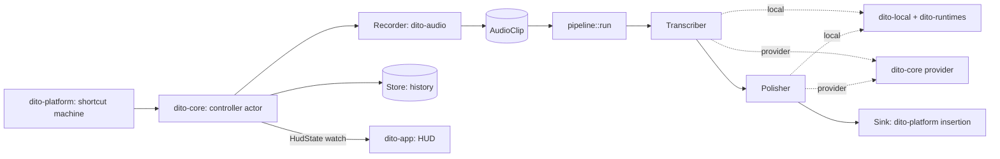

# Architecture

Terms are defined in [GLOSSARY.md](GLOSSARY.md). This document keeps the design of the code from drifting, especially during broad changes by AI agents. It names modules and boundaries, not files. Revisit it when the architecture changes, not on routine edits.

## Overview

Dito is a macOS dictation app. A global shortcut starts a recording; the audio is transcribed (locally or by a cloud provider), optionally polished by a language model, and typed into the app that has focus. A floating HUD shows the progress; a settings window, a menu bar item and an onboarding wizard surround it. The code is a Cargo workspace: a platform-free core, macOS adapters, local model runtimes and a GPUI app on top.

## Codebase Map

- `dito-core`: config, i18n, prompts, the dictation controller and pipeline, the audio clip and its WAV encoding, cloud providers, the SQLite store (history, wordbook, stats), the secrets trait, the text insertion policy.
- `dito-audio`: microphone capture, resampling to 16 kHz mono, device transport detection.
- `dito-local`: local model catalog, downloads, model state and the local engines; runtimes plug in through `RuntimeLoader`.
- `dito-runtimes`: llama.cpp (Metal) and sherpa-onnx bindings behind `dito-local`'s traits.
- `dito-platform`: macOS integration: event tap and shortcut machine, permissions, text insertion, Keychain, music mute, window helpers, login item.
- `dito-testkit`: an in-process mock server for cloud APIs and downloads.
- `dito-app`: the GPUI app: HUD, settings pages, onboarding, menu bar, shared `ui` controls, theme and motion.

## Dictation Flow

The controller owns the run: it starts the recorder, hands the clip to the pipeline, delivers the text through `Sink` and records the result in `Store`. Polish failure skips the polish step and delivers the transcript. The app only observes `HudState` and sends commands.

## Invariants

- **Layer responsibilities**: dictation logic lives in `dito-core`. The app renders and forwards user intent; it never runs dictation logic itself.
- **Dependency direction**: `dito-app` depends on core, audio, local and platform (runtimes and testkit through features). `dito-core` depends on no GPUI, AppKit or platform crate. Only `dito-app` depends on GPUI. Runtimes plug into `dito-local`, not the other way round.
- **Platform boundary**: macOS capabilities reach core only through traits (`Recorder`, `Sink`, `Frontmost`, `FocusWarmer`, `MusicMute`, `SecretStore`, `LocalBackend`, `Engines`).
- **External API access**: only `dito-core` providers and `dito-local` downloads make network calls. Keys come from the Keychain and never appear in config, logs or copied text.
- **State management boundary**:
  - A dictation is owned by the controller actor; the UI observes `HudState` through a watch channel.
  - Settings are owned by `ConfigStore`; each setting is edited in exactly one place (the HUD language selector is the documented exception).
  - Shared services live in `AppState`; pages own their form state and their `MotionScope`.
- **Threading**:
  - AppKit and window calls run on the main thread.
  - The controller, pipeline, providers and downloads run on the Tokio runtime.
  - Model loading, inference, store queries and text insertion run in `spawn_blocking`.
  - The event tap and its dispatcher have their own threads.
- **Behavior that must hold**:
  - A polish failure never loses the transcript.
  - Nothing reports fake success: no runtime means unavailable, shown in red.
  - Text is never typed into Dito's own windows, and a partial insertion is never retried in full.
  - The clipboard is restored only when nothing else has written to it since.
  - UI copy comes from `messages.toml`.
  - The design file leads the code.

## Cross-Cutting Concerns

- **Errors**: core keeps typed error kinds; the UI turns them into localized text. Failures never become empty lists or silent defaults.
- **Logging**: `tracing` with `dito=info` and `dito_audio=debug` by default. Log the operation, phase, result and duration, never keys, full audio or full dictations.
- **Motion**: animation state belongs to a `MotionScope` per owner; durations come from the design's motion tokens.

## Decisions

Significant decisions are recorded in [adr/](adr/README.md), one file each. When a request conflicts with an ADR, don't work around it: explain the conflict, then update or supersede the ADR in the same change.
