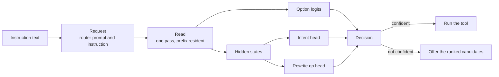

# Intent Routing

How Dito decides what a spoken command asks for. The evidence behind every choice here is in [bench/INTENT.md](../bench/INTENT.md).

## Status

| Piece | State |
| --- | --- |
| Router prompt, heads format, decision and confidence gate (`dito-core`) | Implemented, unit tested |
| One-pass readout on the loaded chat model (`dito-runtimes`) | Implemented, checked against real models by `mise run bench intent parity` |
| Fitted heads for the three Qwen3.5 catalog models | Bundled in `crates/dito-core/src/intent/heads/` |
| Eight intents, with `reply` and `ask`, measured on 600 test cases (93.2%, 95.5% and 96.7% on the 2B, 4B and 9B) | Implemented in the router and the heads |
| Command mode (shortcut, selection capture, tools, HUD windows) | Prototype: one step per instruction, designed in `design:hud/command` |
| Tools for `reply` and `ask` | Built: `reply` ends in the confirm window with Copy only, `ask` in the answer window |
| The `none` intent | Nothing runs: the capsule shows a "not recognized" notice, sure or not (`design:hud/command`) |
| Several steps per instruction | Not built |

This document covers the decision layer. The flow around it is in [ARCHITECTURE.md](ARCHITECTURE.md) under Command Flow.

## Goal

In command mode the user selects text in any app, presses a shortcut and speaks an instruction about it. Before any tool runs, the instruction is classified into one of eight intents, grouped by what the result is to the selected text:

| Result | Intent | Meaning |
| --- | --- | --- |
| Changes the selected text | `polish` | Fix errors and flow without changing purpose, register or length |
| | `rewrite` | Change length, tone, format, audience or wording on purpose |
| | `translate` | Another language or written variety |
| New text made from it | `summarize` | The gist |
| | `reply` | The selection was received (a message, email, comment, review) and the user wants a response to send back, or help with what to say |
| An answer about it | `ask` | A question that expects an answer, about the text or about anything else |
| Control | `cancel` | The user calls it off |
| Not a command | `none` | An action Dito cannot do (send, save, search, open, delete), chit-chat, dictated content or garbled output |

The labeling rules (precedence, boundaries) are in `bench/data/intent/GUIDE.md`; in short, the request standing at the end wins, a negation removes an intent, several requests resolve as `reply`, `translate`, `summarize`, `rewrite`, `polish` in that order, a question about how to respond is `reply`, and any other question is `ask`.

Requirements:

- Local only. The instruction never leaves the Mac (ADR-0002, ADR-0008).
- No second model. The chat model the user already loaded for polishing decides.
- Fast enough to run before every command: tens of milliseconds.
- A confidence the app can act on: run directly when sure, ask when not.

Non-goals: generating the edited text (the tool does that with the same model afterwards), extracting free-form arguments, and routing for cloud polish providers.

## One model, three calls

| Call | Input | Output | Generated tokens |
| --- | --- | --- | ---: |
| Read | Router prompt (prefix resident) and the instruction | Option logits and the hidden states the heads name | 0 |
| Decide | That reading | Intent, probabilities, confidence, rewrite op | 0 |
| Write | The chosen tool's prompt and the selected text | The edited text | As long as the text |

Only the third call generates. The first two replace the usual "ask the model for JSON, then parse it", which on the same models is four to five times slower and less accurate.

## Layers



| Layer | Where | What it owns |
| --- | --- | --- |
| Prompt | `dito-core` `intent::prompt`, `router_system.txt` | The system text with eight lettered options, decision rules, keywords and examples; the user turn with the escaped instruction stated twice |
| Request and reading | `dito-core` `intent::{Request, Reading}` | The contract between core and a runtime |
| Readout | `dito-local` `LlmRuntime::read`, `dito-runtimes` `readout` | One prompt pass on llama.cpp, no sampler |
| Heads | `dito-core` `intent::heads`, `heads/*.heads` | Linear classifiers over the hidden states, with their temperature |
| Decision | `dito-core` `intent::{decide, Decision}` | Probabilities, top intent, the 0.9 gate, ranked candidates |
| Composition | `dito-local` `intent::decide` | Request, read, decide for a loaded model |

Each layer can be replaced alone. A new prompt only needs refitted heads. A model without heads still routes, by the softmax of its option logits.

### Prompt

The system prompt lists one option letter per intent. The model's next-token logits at the answer position, restricted to those eight letters, are already a classifier (the direct readout). Three constructions were kept because they raised training accuracy in the prompt sweep: explicit decision rules (the precedence list and the close calls between neighbouring intents), keywords in three languages next to each option, and examples. The instruction is escaped and fenced in `<instruction>` as reference data (ADR-0012) and stated twice in the user turn.

`router_system.txt` is the only copy of the system text. The bench reads the same file, and each heads file stores the SHA-256 of the prompt it was fitted on.

### Readout

`Chat::read` renders the prompt in the GGUF's chat template, opens the assistant turn with the empty think block Dito already prefills, and decodes once. It returns:

- the logits of the eight option letters at the last prompt token (the answer position);
- for each part the heads ask for, the residual stream entering one block, either at the answer position (`last`) or averaged over the instruction's tokens (`span`).

The router's prompt is 1383 tokens at the median (1357 to 1465 on the test set) and identical across requests up to the instruction. That prefix is decoded once, in batches of at most 1024 tokens, into sequence 0 of a dedicated context and stays there. Each request copies it into sequence 1 and decodes only its own remainder, 60 tokens at the median and 142 at most. Prompt length therefore costs nothing per decision.

### Heads

A head is multinomial logistic regression with a temperature:

```
p = softmax((W * ((x − mean) / scale) + b) / T)
```

`x` is the concatenation of the head's parts. For the 4B model the intent head reads two hidden states of 2560 values each, so it has 8 × 5120 weights and 8 biases. Applying every head of a model takes under 0.1 ms.

Two heads ship per model:

- `intent`: the eight intents. A heads file with another number of classes is refused when it is parsed.
- `rewrite.op`: for a rewrite, which property changes (`expand`, `shorten`, `formal`, `casual`, `format`, `paraphrase`, `audience`). 74% to 82% on the test set, where a case with two actions is labeled by its last. The decision carries it only when the intent is rewrite. The rewrite tool takes it as a hint (one sentence in its prompt, not an order) when its probability is at least 0.8 and the decision itself chose the tool.

No fit selects a mix with the direct readout at present (the 9B's best mix has the same loss as its head alone), but the heads file format carries one as `direct`, and the decision applies it when present. A translate-target head was fitted and is not shipped: 186 training cases and 60 test cases do not rank it reliably (78% to 88%), and the translate tool reads the instruction itself.

### Decision

`Decision::is_confident` is true when the top probability is at least 0.9. On the 600-case test set that covers 81% to 90% of instructions (2B 81.2%, 4B 86.5%, 9B 90.3%), of which 98.8%, 98.5% and 99.3% are right. Below the threshold the caller offers `Decision::ranked` instead of acting.

## What ships with a model

A heads file belongs to one GGUF file and one router prompt. Its header records the catalog id, the SHA-256 of the GGUF and the SHA-256 of the prompt. `dito-local`'s test `bundled_heads_match_the_catalog_file_and_the_router_prompt` fails when either drifts from the catalog or from `router_system.txt`.

The files are compiled into `dito-core` with `include_bytes!`, about 0.3 MB each. A catalog model without a heads file is routed by the direct readout.

| Model | Intent head reads | Mixed with the direct readout |
| --- | --- | --- |
| Qwen3.5 2B | Layer 14 at the answer position and layer 15 over the instruction | No |
| Qwen3.5 4B | Layer 19 at the answer position and layer 17 over the instruction | No |
| Qwen3.5 9B | Layer 20 at the answer position and layer 18 over the instruction | No |

## Refitting

Heads must be refitted when the router prompt changes, when a catalog entry points at another GGUF file (a new quantization or checkpoint), or when training data is added. The second round of training data (1679 cases against 1375) changed the test accuracy by +0.4, 0.0 and +0.4 points, none significant; see Round 1 against round 2 in `bench/INTENT.md`.

```bash
mise run bench intent all              # probe runs, fit, export, parity, tables and charts
cargo test -p dito-local --lib intent  # the bundled heads match the catalog and the prompt
```

The heads in `crates/dito-core/src/intent/heads/` are committed build inputs: building the app never refits and never needs the bench or the models. A refit is a deliberate change, committed together with `bench/results/intent/<chip>/`.

`all` skips probe runs that already exist in `bench/cache/intent/`, which is local only and git-ignored. On a clean checkout it recomputes them from the catalog GGUF files in Dito's model folder: one to three minutes per model for the hidden states, tens of seconds for a fit. When only the fit changed and the stored runs are still valid, `mise run bench intent fit` and `mise run bench intent export` refit and write the heads without probing. The data is `bench/data/intent/` (`test.json`, `train/`, `GUIDE.md`). The steps and their outputs are listed in [bench/INTENT.md](../bench/INTENT.md); the code layout is in [bench/README.md](../bench/README.md).

## Constraints

- **Qwen3.5 memory cannot be truncated.** In llama.cpp the architecture is `qwen35`: every fourth block is full attention and the others are gated delta net blocks with recurrent state. Dropping the tail of a sequence is refused, so the resident prefix is reused by a sequence copy.
- **Layer inputs come from an extension API.** `llama_set_embeddings_layer_inp` and `llama_get_embeddings_layer_inp` are C++ symbols of `llama-ext.h`, which the Rust bindings skip. `dito-runtimes` declares them by their mangled names and takes the raw model handle from `llama-cpp-2`'s transparent wrapper. Both depend on the exact llama.cpp tree, so `llama-cpp-2` and `llama-cpp-sys-2` are pinned to 0.1.160; an upgrade must recheck `crates/dito-runtimes/src/readout.rs`.
- **The output of the last block is not available that way.** Layer `l` means the input of block `l`, for `l` below the block count.
- **A decision context stays loaded.** It is created on the first decision and holds the prefix for both sequences, in addition to the model's own memory.
- **One call at a time.** A decision takes the model's gate like a polish does. It runs before the tool, never beside it.
- **Instructions are short.** A request's remainder must fit one batch of 1024 tokens, because hidden states are kept for the last batch only. The prefix may be longer: it is decoded in batches.
- **The context holds two copies of the prefix.** `CONTEXT_TOKENS` is 4096 for the resident prefix and one request's copy of it; with a 1383 token prompt the room runs out at a prompt of about 1900 tokens, and the constant in `readout.rs` has to grow before the prompt does.

## Toward an agent with tools

`design:hud/command` draws command mode as an agent that works in steps and calls a tool whenever it lacks something. Each tool is a small UI on the capsule (`choose`, `ask_text`, `confirm`, `answer`), and the capsule shows the state the agent is in. The prototype builds these four for a single step. An instruction whose likeliest intent is `none` runs nothing and is never offered in `choose`: the capsule shows the "not recognized" notice, which hides on its own like a dictation error but has no buttons and is not a failure (the run is recorded as closed).

Two of those tools need nothing new from the decision layer. `choose` is the confidence gate: a decision below the threshold hands the ranked intents to the UI. `ask_text` is a check after the decision: the chosen tool works on text and none is selected.

Two things the layer cannot do yet, and one it now does:

- **Plan several steps.** The router picks one intent per instruction, and its training data resolves "summarize and translate" to a single label by precedence. Steps could come from a second decision after each step, from a multi-label head, or from generating a plan. On these models generation was slower and less accurate than reading a decision, so this needs its own measurement before a design is chosen.
- **Tell more intents apart.** A question is `ask`, a response to send is `reply`; a request to generate a plan or other new text is still `none` or `ask`. Each new intent needs training cases and a refit of the heads. The weak boundaries are polish, rewrite and summarize when one instruction names two of them (a third to a half of the out-of-fold errors), and misheard intent words.
- **Reply stance.** The test cards label a reply's stance (accept, decline, ask back, thanks, given); the training data does not, so no head reads it yet.

## Open

- Real speech. Training and test data are synthetic; ASR errors in them are imagined ones. A small set of real transcripts has to confirm the numbers before command mode ships.
- Selection context. "Make this natural business English" is a translation or a rewrite depending on the language of the selected text. The router does not see the selection yet. The tools do: they get the text around the selection as reference (ARCHITECTURE.md, Command Flow), but the router still reads the instruction only.
- Unloading. Whether the decision context should be freed after idle time is undecided.
- An ADR. When command mode is adopted, record the decision (readout over generation, heads bound to a model file) in `docs/adr/`.
